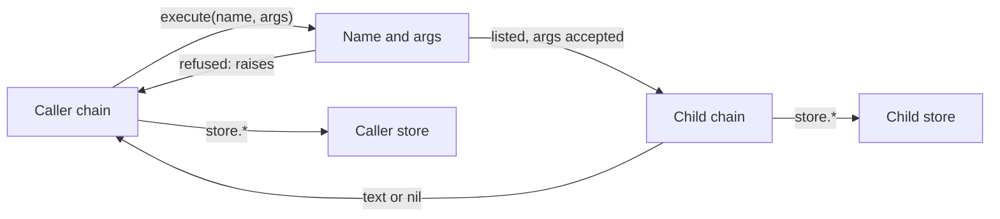

# Execute child prompts

Basis: read at `runvil-harness` `67d9d1b4`. Nothing was built or run.

## The rule

- **Frontmatter.** A prompt lists the prompts it may execute, by the names the `PromptFinder` knows, which are the names `Prompt::file` returns:

```yaml
prompts:
  - report.md
  - review.md
```

- **Parse.** `Prompt::parse(finder, name)` parses the main prompt, then every prompt its list reaches, each once. A missing or malformed child fails the parse, so nothing is looked up during a run. Every find therefore happens inside `Host::parse`, which keeps the Harness's rule that no finder is called, and no prompt file read, once a run exists.
- **One run.** `execute(name, args?)` runs that prompt as a blocking child chain of its caller. It is not a run of its own: it has the same scheduler, cancel flag, event log, files, and Packs, and it counts against the same limits.
  - A task the child spawns is admitted under its caller's concurrency share and every ancestor's, up to the run's ceiling, and it counts toward the run's idle-task cap.
  - The child runs one level deeper than its caller, under the one call-depth cap.
  - Its tool calls count toward the Harness's one cap on tool calls in flight, and they work in the run's files under its caller's file access.
- **Packs.** The run holds every Pack the Host installed, one instance of each, whatever any of its prompts names. A prompt's `uses:` marks the Packs that prompt requires and whose preludes install in its own sections. Every other Pack is its extra. So a child's `uses:` changes nothing its caller sees.
- **Arguments.** `args` is a table of named fields, or a string, which is the one field `text`, as `call` takes them. The child's `args:` declaration checks them and fills its defaults, as it does for a run. A mismatch raises `args_invalid` in the caller, and no arguments means `{}`.
- **Store.** Each execution gets a new store: empty, with its own claims ledger, and gone when the child ends. The child's `call` chains and tasks share it. The caller and the child see none of each other's store.
- **Start.** The child starts at its first top-level section, the preamble when it has one, and falls through as a main prompt does.
- **Isolation.** `call`, `jump`, `require`, and the `prompt` reads only see the prompt they are written in.
- **What crosses.** Only the arguments, and the result comes back as text. The child gets a fresh `var` and starts on the `default` model.
- **Result.** The child's text, or nil when it ended with no text, as `call` gives. A failed child raises in the caller.
- **Listing is per prompt.** If A lists B and B lists C, B may execute C and A may not.
- **Recursion** is allowed. The depth cap of 8 stops it.



## Decisions I made where you left room

- **The key is `prompts:`** (medium confidence - a naming call).
- **`execute` checks the arguments, where `call` does not** (high confidence - the declaration states what a caller passes the prompt, and `execute` is such a caller).
- **Every prompt is checked up front.** The first step refuses the run if any prompt's `runvil:` version, Packs, or model roles are unmet (high confidence - you asked for this).
- **Each prompt has its own model set**, because a role's thinking switch comes from that prompt's `models:` (medium confidence - one set cannot hold two prompts' switches).
- **Two prompts that name two vendors of one Pack id need no check of their own.** A Host holds one Pack per id, so one of the two entries names a Pack the Host lacks, and `Host::parse` refuses the prompt (high confidence - read in `PackRegistry::add` and `Packs::find`).
- **A prelude that fails to load is found when its prompt's first section starts**, as the error `execute` raises for a child (medium confidence - it is a Pack bug, and an earlier check means a throwaway VM per prompt).
- **A `Vfs` record names its store by a chain id**: the root chain's for the run's store, and the child chain's for a store that `execute` made. A blocking child reports under its caller's task, so without the id a log could not tell the caller's `a.md` from the child's, and neither store could be rebuilt from it (medium confidence - a chain id is the same on every run of the same prompt, which a replay needs; the field's name and form are open).
- **`execute` works wherever `call` works**: the preamble, a library, a task (medium confidence - the preamble is an ordinary section).
- **The caller is parked as on a `call`**, so `tasks.status` reports `call` (medium confidence - a second name for the same wait adds nothing).
- **No new event is added.**

## Step 1: parse the listed prompts

One commit: `runvil-prompt`, both facade listings, and the plan copy.

- [frontmatter.rs](runvil-harness/crates/runvil-internal/prompt/src/frontmatter.rs): a `prompts: Vec<String>` field and `Frontmatter::prompts()`. An empty or repeated name is `FrontmatterInvalid` on the `prompts:` line.
- [prompt.rs](runvil-harness/crates/runvil-internal/prompt/src/prompt.rs): a flat table of the other prompts reached, `BTreeMap<String, Arc<Prompt>>`, filled only on the prompt `parse` returns, and a public `Prompt::linked()` over it in name order.
- [parse.rs](runvil-harness/crates/runvil-internal/prompt/src/parse.rs): a worklist around `parse_source`. The main prompt's own name is skipped, so a cycle back to it resolves to the main prompt at run time.
  - A child's parse failure is located in the child's file.
  - A finder failure for a child comes back as given, placed on the listing prompt's `prompts:` line when the finder gave no place. A stock finder's `no prompt named review.md` gives none, so the place says which prompt listed the name.
- Tests: a chain of three, a cycle, a shared child parsed once, a prompt that lists itself, each failure.
- The `prompt` module docs of both facades name the list, and `xtask api --bless` records the two new methods.

## Step 2: the Harness reads every prompt's `uses:`

One commit, `harness-runner`. The run's Packs stay the Host's: these three functions read `uses:` for what a prompt requires.

- [packs.rs](runvil-harness/crates/harness-internal/runner/src/packs.rs): each reads the `uses:` entries of the main prompt, then of each linked prompt in name order, and counts a Pack once however many prompts name it.
  - `pick` resolves those entries, so an entry of a linked prompt that the Host cannot serve is on the roster with its reason, as a main prompt's is.
  - `refusals` names each such entry, so [host.rs](runvil-harness/crates/harness-internal/runner/src/host.rs) `Host::parse` refuses a prompt whose child requires a Pack the Host cannot serve.
  - `preludes` gives the Engine one `Prelude` per usable Pack any prompt names. The Engine decides which prompt's sections install it.
- Tests:
  - Each of the three over a prompt with a linked prompt, and `a_runs_roster_and_catalog_are_the_same_whatever_its_prompt_declares` covers a linked prompt's `uses:` too.
  - Through `Host::parse` on a `PromptSet`: one parse reads a prompt and the prompt it lists, and a listed name the set lacks fails the parse at the listing prompt's `prompts:` line.
  - A run that has started keeps its prompts when the set is rescanned without the linked file, and the next `Host::parse` fails.

## Step 3: per-prompt state on the chain

One commit, `runvil-runtime`. A prompt with no list behaves as before.

- [context.rs](runvil-harness/crates/runvil-internal/runtime/src/execute/context.rs):
  - `prompt`, `model_set`, `tool_set`, and `preludes` move from `SharedState` into one per-prompt bundle that `ChainState` holds. `SharedState` keeps a table of bundles by name, built in `ChainState::root`.
  - A bundle's tool set is `ToolSet::new` over the run's roster and catalog with its prompt's `uses:` as the declared Packs. `declared` has two readers, both in `runvil-lua`'s `packs.rs`: a Pack object's `required` flag and the `extras` list.
  - `store` moves from `SharedState` to `ChainState`, beside the id of the chain it was made for. `ChainState::store()` keeps its name, so `dispatch_vfs` reads it as it does today.
  - A new fork beside `with_args` switches a state to another prompt, with its arguments and a new `Store`.
  - A bundle's preludes are the run's preludes filtered to the Pack ids its prompt names, in that prompt's order. `install_preludes` is unchanged.
  - `max_tool_iterations`, `section_count`, and the `file` in `vm_setup` read the prompt through the state, so they follow the chain.
- [requirements.rs](runvil-harness/crates/runvil-internal/runtime/src/execute/requirements.rs) and [fill.rs](runvil-harness/crates/runvil-internal/runtime/src/execute/fill.rs): gaps are gathered over every prompt. A line for a linked prompt names it, and the refusal is placed in the first prompt with a gap.
- [drive.rs](runvil-harness/crates/runvil-internal/runtime/src/execute/scheduler/drive.rs): `check_start` applies the version gate to every prompt. Its check of the run's arguments stays on the main prompt.
- Four scheduler sites act for one chain and read the run's prompt today. Each reads that chain's: `step_chain`, `finish`, and `prepare_spawn` through `Scheduler::prompt()`, and the file `settle_owned_tasks` places a live-task error in. The run's start, its reports, and `deliver_message` stay on the main prompt.
- The test hook `with_models_for_test` sets the main prompt's bundle.
- [type_size.rs](runvil-harness/crates/build-xtask/src/type_size.rs): the entry that records `SharedState` at 15 fields takes its new count, or goes if the count is under the limit.
- Tests: a linked prompt's missing Pack, unmet model role, and bad version each refuse the run at the first step and name the prompt.

## Step 4: `execute`

One commit: `runvil-prompt`, `runvil-lua`, `runvil-runtime`, the Harness's effect loop, and both facade listings.

- [args_check.rs](runvil-harness/crates/runvil-internal/prompt/src/contract/args_check.rs) and [detail.rs](runvil-harness/crates/runvil-internal/prompt/src/detail.rs): `accept` reads text and then checks the object. The second half becomes a function of its own, which `detail` offers beside `accept_args`, so a chain's arguments are checked as a JSON value.
- [__impl_coro.lua](runvil-harness/crates/runvil-internal/lua/src/__impl_coro.lua): an `execute(name, args)` shim that yields `{ op = "execute", name, args }`, with no `var` and no `from`.
- [request.rs](runvil-harness/crates/runvil-internal/lua/src/protocol/request.rs) and [parse.rs](runvil-harness/crates/runvil-internal/lua/src/protocol/parse.rs): `Request::Execute { name, args }`, with `args` read by `call_args`.
- [coro.rs](runvil-harness/crates/runvil-internal/lua/src/coro.rs) and [globals.rs](runvil-harness/crates/runvil-internal/lua/src/globals.rs): install the global and reserve the name. A library reads every global but `call`, `prompt`, and `tasks` from the VM's globals, so it gets `execute` with no version of its own.
- [dispatch.rs](runvil-harness/crates/runvil-internal/runtime/src/execute/scheduler/dispatch.rs): `dispatch_execute` beside `dispatch_call`, parked as `Parked::Call`. The child is a `ChainKind::Call` chain built as `prepare_call` builds one, on its caller's access, except:
  - its state is the caller's, switched to the child prompt with a new store and the arguments the child's declaration accepted: a string as the field `text`, and `{}` for none
  - it starts at `SectionPos::top(SectionIndex::FIRST)`
  - its `var` is `{}`
  - its model is the child bundle's `default` binding
- A name the calling prompt did not list raises a `LuaRuntime` failure that names the prompt and what it lists, as a `call` of a missing section does. Refused arguments raise the `ArgsInvalid` failure the check returns. Both come before the child takes its chain id, which is also its store's id.
- [effect.rs](runvil-harness/crates/runvil-internal/runtime/src/execute/run/effect.rs): `Effect::Vfs` and `EffectRecord::Vfs` gain the store's id, which `dispatch_vfs` reads from the chain's state.
  - The sites outside the runtime that match `Effect::Vfs { access, op }` take the field: [effect_loop.rs](runvil-harness/crates/harness-internal/runner/src/effect_loop.rs), the `greeter` example, and three files of the engine suite.

Tests, through `Scenario`, which gains named prompt sources:

- The child's preamble runs first, then its sections. A `return` in the preamble ends only the child.
- Arguments: a table, a string as `text`, none with the child's defaults filled, the caller's own `args` passed on, a child with no `args:` key. A missing required field, a wrong type, and an undeclared field each raise `args_invalid` in the caller, which `pcall` catches, and the child does not start.
- Fresh `var` and the `default` model. The caller's `var` and `args` are unchanged afterward.
- Text, nil for no text, nil for a child with no section, a failed child caught with `pcall`, and its error placed in the child's file.
- The store:
  - The child starts empty when the caller has written files, and the caller sees none of the child's files afterward.
  - The same child executed twice starts empty both times.
  - Two fanout arms that execute the same child, which writes one path, both succeed.
  - A `call` and a task inside the child share the child's store, and two tasks of the child with no order between them still conflict on one path.
  - A child that executes another prompt gives it a third store.
  - The run's `Vfs` records, grouped by store id, rebuild each store.
- A tool call in the child reads a file that a tool call of its caller wrote, with no conflict.
- The same section name in both prompts. A `call` or `prompt.section` in the child cannot reach the parent's sections.
- A lists B, B lists C: B executes C, and A's `execute` of C raises.
- A and B execute each other until `call_depth_exceeded`.
- Preludes, with A naming Pack `x` and B naming Pack `y`: each prompt's sections see only their own Pack's global, before and after the `execute`. A Pack both name installs in both. Two Packs that define the same global collide only when one prompt names both.
- `tools.packs` in each prompt marks that prompt's own `uses:` as required and lists the run's other Packs as extras, and a caller's list is the same before and after it executes a child. A role's thinking switch follows the running prompt.
- `execute` from the preamble, a library, and a task. Cancel while the child runs.

## Step 5: documents

One commit each, once the code passes. The two can be written at the same time.

- **`runvil-design`:** in [architect-runvil-prompting-language.md](runvil-design/design/architect-runvil-prompting-language.md), the `execute` entry and every sentence about it state the rule above, and `execute_async` stays deferred. [engine.md](runvil-design/decisions/engine.md), [prompt-language.md](runvil-design/decisions/prompt-language.md), and [harness-and-host.md](runvil-design/decisions/harness-and-host.md) state child prompts as built, the last one also that a prompt with a list needs a finder that serves each listed name, such as a `PromptSet`. [files-and-the-vfs.md](runvil-design/decisions/files-and-the-vfs.md) states a child's store and the store id of a `Vfs` record, and [tools-and-packs.md](runvil-design/decisions/tools-and-packs.md) states what a linked prompt's `uses:` does.
- **`runvil-docs`:** chapters 2 (the key), 5 (the global), 6 (a child's arguments), 8 (`execute` beside `call`), 9 (a child's store), 12 (a linked prompt's `uses:` and preludes), 16, and 17. Example values come from the built Engine, and `cargo xtask site --books-only` builds the books.

## Left out

- `execute_async`, the `runvil/subagents` tools, and replay.
- The Workshop, which pins `runvil-harness` by commit.

## Verification and git

- Every command in [AGENTS.md](runvil-harness/AGENTS.md) passes before each `runvil-harness` commit.
- Comments and documents describe what is there. A sweep of the added lines for `no longer`, `formerly`, `previously`, and `used to` finds nothing.
- Commits go on `master`. `runvil-harness` commits end with `Plan: /plan/2026-11-14-4-execute-child-prompts.plan.md`, and the other repositories' with `Plan: runvil-harness/plan/2026-11-14-4-execute-child-prompts.plan.md`. Pushing is yours to call.

## Order

- Step 1 gives every later step the list and the table.
- Step 2 comes before step 3, so the roster reports a linked prompt's unserved Pack, and the run's preludes hold a linked prompt's, when the Engine starts reading them.
- Step 4 needs step 3's per-chain prompt and store.
- Step 5 needs the built Engine.

## What the build found

The design held. These points differ from the plan above, or add to it.

The steps:

- **`Scenario` took its named prompt sources in step 3.** The tests of step 3 need a run that links prompts, so `Scenario::prompt(name, source)` is in that commit, for the runtime's test support and for the facade's suite. The plan put it in step 4.
- **The run half of one step 2 test is in step 4.** Step 2 shows through `Host::parse` on a `PromptSet` that the parsed prompt keeps the prompts it links after a rescan, and that the next parse fails. Only a run with `execute` can show that it executes such a prompt, so `a_run_executes_the_prompt_its_parse_linked_though_the_set_has_lost_that_prompts_file` is in `harness-execute.rs`, in the step 4 commit.
- **Between the commits of step 2 and step 3, a section installed every prelude the run was given**, a linked prompt's included. The Harness passed them from step 2 on, and the Engine picks each prompt's own from step 3 on.

Parse:

- **The parse reads the lists breadth first.** `parse_linked` keeps a queue of the prompts whose lists are unread, and `parse_listed` finds each listed name that is neither the main prompt nor in the table. So a listed prompt is parsed after the whole body of the prompt that lists it.
- **A refused list has a `Reason` fact**, `prompt_empty` or `prompt_duplicate`, and a repeated name is its `Name` fact.
- **Each facade listing gained two lines**, for `Prompt::linked` and `Frontmatter::prompts`.
- **The message for an unknown frontmatter key lists `prompts`**, because serde writes the fields it expects. The guide quotes that message in chapter 2.

The Harness:

- **`declared` is the one reader of the `uses:` entries.** It gives the entries of the run's own prompt in declaration order, then those of each linked prompt in the order of the prompts' names, and it reads an entry that two prompts declare once. `pick`, `refusals`, and `preludes` go through it.
- **A Pack id that two unresolved entries name keeps the first reason.** A resolved Pack whose Pack id an unresolved entry of another prompt names stays out of the run.
- **The line of `Host::parse` for a linked prompt's Pack starts with the prompt's name**, as in `- review.md: web is unavailable: runvil/web is not installed`.

The Engine's state:

- **The bundle is `PromptState`.** `RunSets` holds what the params give every prompt alike. `Requirements` gathers the gaps of every prompt: `check_run` once for the run, then `check_packs` and `fill_model_set` for each prompt.
- **The notice orders its lines by kind first**: missing Packs, unavailable Packs, reserved ids, then models. Within a kind, the run's own prompt comes first and the linked prompts follow in the order of their names. A Pack that two prompts declare has one line.
- **The refusal is placed in the first prompt that caused a gap**, on its `uses:` key when it has a Pack gap and on its `models:` key otherwise. A refusal made only of the caller's gaps has no place.
- **The `SharedState` entry left the type-size allowlist.** The struct has 10 fields, and one more under test.
- **`with_prompt` waited one commit for its caller.** The step 3 commit has it with an `expect` of `dead_code` outside tests, and the step 4 commit calls it.
- **Engine tests that pass preludes declare their Packs**, because a section installs only the preludes of the Packs its prompt declares.

`execute`:

- **A chain holds its store behind an `Option`.** `finish`, `abort_subtree`, and `teardown` each call `release_store`, and `ChainState::store()` fails as an internal failure after that. This is how a store is gone when the executed prompt ends: the store is freed once the last chain that shared it has ended.
- **Two helpers moved to `PromptState`.** `max_tool_iterations` and `section_count` left `ChainState`, which keeps it within the limit of 25 methods with no allowlist entry.
- **`args_invalid` has the kind `lua` in Lua.** The code could not reach Lua before `execute`, so `kind_of` had no arm for it. A caught refusal reads `err.kind == 'lua'` and `err.code == 'args_invalid'`.
- **The prose of `CallDepthExceeded` names `execute`**: ``Nest `call`, `execute`, `tasks.spawn`, and `tasks.fanout` less deeply.`` The guide quotes it in chapters 5, 8, 14, 15, and 16.
- **A run built over a linked prompt holds that prompt alone.** `Prompt::linked` gives prompts whose own tables are empty. In a run built over one of them, an `execute` of another prompt that it lists is `make_prompt_not_held_error`, an internal failure. The doc of `Run::new` says to build a run over the prompt that a parse returned.
- **`execute` also works while a library loads, and in an adhoc tool handler.** A library of an executed prompt executes from that prompt's list.
- **An `execute` sends no `var`.** So an `execute` after `var = 5` starts, where a `call` raises the refusal of a reassigned `var`.
- **A prelude that fails to load in an executed prompt is raised at the `execute`**, placed on the caller's line. A linked prompt that no `execute` runs installs no prelude.
- **The `runvil-engine` listing gained one line**, `Effect::Vfs::store`. The `runvil` listing did not change, because `runvil` leaves `Effect` out.
- **A few docs outside the plan's files changed**: the docs of `ArgsInvalid` and `CallDepthExceeded` and three module docs in `runvil-types`, the crate docs of both facades, the READMEs of `runvil-lua` and `runvil-runtime`, and the `AGENTS.md` of `runvil-runtime`.

Tests and checks:

- **The whole workspace runs 3,927 tests, all passing, and skips 24.** It ran 3,818 before. 61 of the 109 are in the step 4 commit: most in `tests/execute.rs` and its five children, with `harness-execute.rs` for the Harness and `suite/execute.rs` for the facade.
- **Every command in `AGENTS.md` passed before each of the four code commits and on the final tree**, and so did `cargo run -p runvil --example run-prompt`, the doc build of `runvil` alone, the private-items doc build of `runvil-runtime`, and `cargo deny check`.
- **The sweep of the added lines has one hit outside this plan copy**, and it is no history word: the one-line paragraph of the README of `runvil-runtime` names the Harness, as it did before, to say who performs an effect.

Documents:

- **The design pages have eleven more entries**, so `decisions/README.md` counts 557. `engine.md` has three, `prompt-language.md` four, `files-and-the-vfs.md` two, and `harness-and-host.md` and `tools-and-packs.md` one each. `tasks-and-fanout.md` names `execute` in the depth cap, the chains of a run, and the inbox rule.
- **`harness-and-host.md` counts 121 re-exports of `runvil`**, where it said 118. The three stock prompt finders are the difference, and the page had not named them.
- **The planned work of two design pages lists `execute_async`** in the place of child prompts.
- **The guide changed in sixteen chapters, where the plan named eight.** Chapters 2, 5, 6, 8, 9, 12, 16, and 17 teach the rule, with five sections of their own beside "Executing another prompt" in chapter 8. Chapters 4 and 10 say that the start checks cover every listed prompt and that an executed prompt starts on `default`. Chapters 1, 3, 7, 11, 14, and 15 have the sentences that the rule made incomplete. Chapter 13 needed no change.
- **The guide checker finds its prompts by name.** An example that lists another prompt finds it among the other examples of its chapter, and the Harness probe takes named prompts the same way. Both are scratch programs outside this repository.
- **The guide checker finds 559 examples, and 377 return their documented result.** It found 529 and 362 before. Every example that returned its documented result still does. It found 2,317 links and no broken one, and `cargo xtask site --books-only` built both books.
- **Four statements of the guide come from tests**, because neither program can show them: that tool calls of an executed prompt count toward the Harness's one number of calls at once, that they work in the run's files, that a notice line reads `- review.md: missing required Pack: gone` for a Pack that only a listed prompt declares, and where a refusal is placed when one prompt has a Pack gap and another a model gap.
- **The runs for the guide showed four things that the plan does not say.** An empty Lua table is the empty object, so `{ tags = {} }` is refused for a field that the executed prompt declares as an array, and `json.array()` passes. A float with no fraction arrives as an integer, as it does through `call`. A refused `execute` inside an adhoc tool handler ends an uncaught `models.loop` as `lua_runtime`, by the rule for a `lua` value that the loop raises again. A task that waits on an `execute` reports `blocked` as `call`, and as `inbox` while the executed prompt idles after its own `tasks.reply`.
- **Two differences between the guide and the code stay, both older than this plan.** The guide shows `- missing required Pack: web` for a Pack that the Host lacks, where `Host::parse` refuses first with `- web is unavailable: runvil/web is not installed`. Chapter 15 says that a task waiting in `tasks.receive()` reports `blocked` as `inbox`, and inside a section that the task runs with `call`, or a prompt that it runs with `execute`, the field reads `call`.
- **Commits.** `runvil-design` commit `7e85172` and `runvil-docs` commit `1d28c66` hold the document changes. The code is in `e8d396f0`, `c5ffae66`, `65d2cfb4`, and `a3e29216`. Each is local on `master`.

