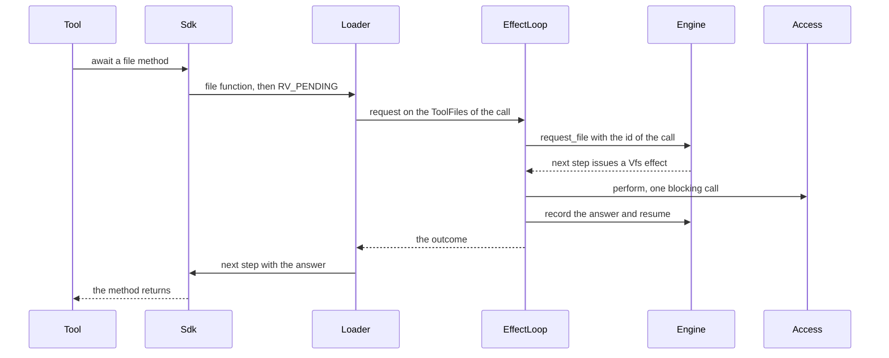

# Tool file operations as effects

## Start here

This section is for an agent that starts with this file and no earlier conversation.

- The workspace is `c:\Users\Vinnie\cursor`. Each repository named in this plan is a folder in it, and the shell is PowerShell on Windows.
- All of the code in this plan is still to be written. The newest commit in each repository is from 2026-11-15, and it changed comments and pages.
- Read the `AGENTS.md` of each repository before you change it.
- In `runvil-harness`, read [runvil-harness/decisions/files-and-the-vfs.md](runvil-harness/decisions/files-and-the-vfs.md), [runvil-harness/decisions/tools-and-packs.md](runvil-harness/decisions/tools-and-packs.md), [runvil-harness/decisions/engine.md](runvil-harness/decisions/engine.md), and [runvil-harness/decisions/harness-and-host.md](runvil-harness/decisions/harness-and-host.md). They state the code as it is, with the decisions of 2026-11-15. The decisions of 2026-11-16 and 2026-11-17 in this plan are newer than the pages, and this plan is the authority for them.
- For background written for a newcomer, read `cabinet/_output/report-tool-file-effects-plan.md` in the workspace. Where that report and this plan differ, this plan is right.

The repositories:

- `runvil-harness`: the Engine, the Harness, and the decision pages. `origin` is the owner's fork.
- `runvil-plugin-api`: the C contract and the SDK. `origin` is the owner's fork, and `upstream` is `cppalliance/runvil-plugin-api`. Local `master` tracks `upstream/master`.
- `runvil-plugin-std`: the `std` Pack. `origin` is the owner's fork, and `upstream` is `cppalliance/runvil-plugin-std`. Local `master` tracks `upstream/master`.
- `runvil-plugin-bashkit`: the `bash` Pack. `origin` is `cppalliance/runvil-plugin-bashkit`.
- `runvil-workshop`: the Host application. It stays as it is.

## Rules for all work

- Every commit goes on `master`, the one branch in use. After a commit passes its checks, push it with `git push origin master`. Pushing to `upstream`, merging, and tagging are the owner's.
- Before the first change in a repository, run `git status`. A tree with changes from outside this plan means stop and report.
- One step is one commit, unless the step says otherwise. Every commit builds and passes every check in the repository's `AGENTS.md`. In `runvil-harness`, a commit runs a format check, and a push runs the wording scan, clippy, and `cargo deny`.
- Write each commit message by `c:\Users\Vinnie\cursor\.cursor\rules\commit.mdc`, with its text free of any mention of this plan. End it with one trailer line: `Plan: /plan/2026-11-16-1-tool-file-effects.plan.md` in `runvil-harness`, and `Plan: runvil-harness/plan/2026-11-16-1-tool-file-effects.plan.md` in every other repository.
- A file that goes is moved to `c:\Users\Vinnie\cursor\cabinet\_trash\`. That move is the one way a file leaves a repository.
- Each change leaves one form of each thing. Compatibility code, aliases, and fallbacks stay out, and a test of a rule that goes is removed with the rule.
- Comments, crate docs, READMEs, error messages, and pages state the rule as it is, with its history left out. After the last commit of a package, search the lines you added for `no longer`, `formerly`, `previously`, `used to`, `legacy`, `deprecat`, `migrat`, `replaced`, `renamed`, and `changed`, and reword each hit.
- In the Engine crates, which are `runvil-engine` and the crates under `crates/runvil-internal`, docs and names say "the caller" for the code that steps a run. `node --test tools/docs-claims.mjs` checks this.
- A commit in `runvil-harness` edits the decision pages for every rule it changes. Quote the owner exactly. The quotes for the decisions of 2026-11-16 and 2026-11-17 are in this plan.
- When the code and this plan disagree, or a step fails as written, stop and report what you found. A small difference that the code settles goes into your report.
- End each package with a report: each commit with its hash and subject, each check with its result, and each point where the work differed from this plan.

## Work packages

The work is cut into packages, so that one agent holds one repository at a time. Each package can go to a fresh agent together with this file. The handoff is one sentence that names this file and the package: "Read the plan from 'Start here' through 'State', then do Package C." For Packages D, E, and F the sentence adds the merged hash.

- Package 0, the plan copy. Copy this file to `runvil-harness/plan/2026-11-16-1-tool-file-effects.plan.md`, commit it alone, and push. Every later package works from that copy.
- Package A, in `runvil-plugin-bashkit`: Step 1.
- Package B, in `runvil-plugin-api`: Steps 2 and 3. It ends with a push to `origin` and a report that gives the hash of its last commit.
- The owner's merge. When Package B has reported, the owner merges into `cppalliance/runvil-plugin-api` and names the commit that is on `upstream/master`. That hash goes under "State".
- Package C, in `runvil-harness`: Steps 4, 5, 6, and 7, in that order. It needs nothing from the contract, so it can run while Packages A and B run.
- Package D, in `runvil-harness`: Steps 8 and 9. It needs Package C and the merged hash. Its report starts with the numbers of the measurement in Step 8.
- Package E, in `runvil-plugin-std`: Steps 10 to 13. It needs the merged hash.
- Package F, in `runvil-plugin-bashkit`: Steps 14 and 15. It needs Package A and the merged hash.
- Package G, in `runvil-harness`, after every other package. It updates the `bash` and `std` entries of the tools page, completes "What the build found" in the plan copy from the reports of the packages, and marks the todos done.

Packages A, B, and C are in three repositories and can run at the same time, after Package 0. Packages D, E, and F can run at the same time for the same reason. Two packages in one repository run one after the other.

A fault in the contract that a later package finds goes back to `runvil-plugin-api` as a new commit. The owner merges it, the new hash goes under "State", and each repository that has pinned the contract moves its pin in a commit of its own.

Packages D, E, and F each start by confirming the merged hash: `git fetch upstream` in `runvil-plugin-api`, then `git branch -r --contains <hash>`, which must list `upstream/master`.

## State

Whoever hands out the packages keeps this section current in the plan copy.

- Merged contract commit on `cppalliance/runvil-plugin-api`: `52a4905aca0a9c945a93dc4ee7ea815db85612e4`
- Packages finished: 0, A, B, C

## What this plan builds

A tool asks for a file operation and waits. The Engine issues an effect for it, the Harness performs it with one blocking call and records it, and a later step of the tool gets the answer.



A `store` call from Lua is a `Vfs` effect today and stays one. The two share one list of operations, and the effect says who asked.

## Decided on 2026-11-15

- Storage and `Access` stay synchronous. The Harness performs each file effect inline, with one blocking call.
- The `ToolCall` effect stays open until the tool returns its result. The Harness reports each file request through a new method on `Run`.
- The file-changing tools of one model reply run one after another, in the order the model listed them. A tool declares that it changes files.
- Each Shell call gets a new shell.
- Every commit goes to `master` and is pushed to `origin`, with a message written by `.cursor/rules/commit.mdc`.

## Decided on 2026-11-16

- Lua's `store` functions and a tool's file functions are two views of one list of operations, and the Engine uses the `Vfs` effect for both. The effect says who asked: the prompt's Lua, or a tool call. This replaces the effect kind and the operation type that this plan first gave to a tool. The owner's reason: "in principle, the store is just a virtual directory in the file system that is unique to a prompt."
- `store.mount` is left out of this plan. The owner's words: "I am not sure about the store.mount feature." A tool's file operations reach the Host's files alone, as today, and a store stays Lua's. A store therefore has Lua parties alone, and every conflict in one ends the run, as today.

## Decided on 2026-11-17

- The conflict check applies to a store alone. A conflict in a store ends the run with the code `determinism`, as today. The Host's files have no conflict check: an operation on them makes no claim and checks none, whoever asked for it, the prompt's own `tools.call` included. This replaces the rule of 2026-11-16, under which a conflict on the Host's files ended the run unless a model asked for both operations, and went back to the tool as an error when a model did.
  - The owner's reason: "maybe the determinism error should only apply to store operations? and we should otherwise try to behave like regular harnesses, so that two subagents which conflict on file access can just work it out".
  - On the prompt's own `tools.call`, the owner's words: "I think I am ok with Lua's own tools.call on Host files being unchecked. We can always put it back in later."
  - The store is the prompt's own memory, and every party in it is Lua, so the check stays there. The Host's files are the outside world: with a real folder mounted, another program can change a file, and the claims table knows the run's own identities alone.
  - Two tasks that work on one file both succeed. A reader in one task holds back no writer in another, and the later write is the content.
  - Replay stays whole, because every file operation is a recorded effect that the Harness performs in order.
  - One gap is known. A tool that edits a file as a read followed by a write can lose an edit that another task makes between the two. The VFS has an operation that replaces text in one step, `StrReplace`. A Rust Pack can ask for it through `ToolFiles`, and the C contract has no function for it, so the tools of `std` and `bash` cannot. Whether to add that function is the owner's to decide, and it is outside this plan.
- The owner merges the contract into `cppalliance/runvil-plugin-api` right after Phase 2, when its two steps are pushed. The loader is built after the merge, and the measurement runs once, in the loader's step, through the test Plugin. This replaces the decision of 2026-11-16 to prove the contract before the merge, which held uncommitted work in `runvil-harness` across the merge and made the `std` and `bash` Packs wait for the harness. Nothing uses the contract yet, so a fault that turns up later costs one more commit there and a move of each pin. The owner's words: "yes merge the contract right after phase 2".

## Choices this plan makes

Each one is a default that is easy to change before the work starts.

- Names: `Run::request_file`, `VfsAsker`, `VfsReceipt`, `EffectAnswer::VfsReceipt`, `ToolFiles`, `ToolContext::files()`, `ToolInfo::changes_files`.
- What the record holds. Each `Vfs` record names who asked and which files the operation worked on: a store, by the id of its chain, or the Host's files. A write or an append records its bytes, as text when they are UTF-8 and as hex otherwise. An answer for Lua records the whole result, as today, because a replay resumes Lua with it. An answer for a tool records a size, the number of bytes of a read or the number of entries of a listing, and a stat's answer records the stat. The tool's own result is in the record as the answer of its `ToolCall`. A failure records its kind and message. The record holds no hash. Confidence: medium, because no reader of these records exists yet.
- The Engine reports no event for a tool's file operation. The effect record and the answer record are the view. A `store` call keeps its events.
- `runvil-vfs` is std only, and its manifest test enforces that, so `VfsOp` and `VfsOutcome` derive no serde there. The Engine's record code keeps a private serde form of each, which writes what the record holds today. The other place for the two types is `runvil-types`, with the function that performs an operation outside `runvil-vfs`. Confidence: medium, because the record form of `VfsOp` is serde's own today.
- `store.delete` succeeds on an absent path, and a tool's remove fails with `NotFound`. They are two operations of the list, `Delete` and `Remove`, so the record shows which one ran.
- The switch that turns the claims check off is private to `runvil-vfs`. A handle that a Host builds checks nothing, and a store asks for the check when it is made. The claims code and its tests stay, so that turning the check back on is one line. Confidence: medium, because the construction of a handle was read and the change is still to be built.
- The contract allows one request outstanding for each call. The SDK queues further requests and sends them in order.
- The contract has nine file functions and no `exists`, because a stat answers it.
- The shell answers `chmod` and `set_modified_time` inside the Plugin (Phase 5). Confidence: low, because bashkit's use of them is read from its source and untested.
- The SDK gets no adapter for synchronous tools.

## Out of scope

Glob in `std`, Workshop's pins, the classroom tutorial, `store.mount` and any other way for a tool to reach a store, approvals, a wake function, and a contract function for an edit as one operation. A coarser operation for Grep stays out unless the measurement of Step 8 calls for one, and then the owner decides. Workshop moves its four pins in one later change, because one build holds one version of the contract.

## Phase 1 - bashkit: a shell for each call

This phase is Step 1. It stays on SDK 0.4 and lands alone. Files: [runvil-plugin-bashkit/crates/plugin-bashkit/src/session.rs](runvil-plugin-bashkit/crates/plugin-bashkit/src/session.rs), [runvil-plugin-bashkit/crates/plugin-bashkit/src/pack.rs](runvil-plugin-bashkit/crates/plugin-bashkit/src/pack.rs), [runvil-plugin-bashkit/crates/plugin-bashkit/src/shell.rs](runvil-plugin-bashkit/crates/plugin-bashkit/src/shell.rs), [runvil-plugin-bashkit/crates/plugin-bashkit/schemas/shell.json](runvil-plugin-bashkit/crates/plugin-bashkit/schemas/shell.json).

- Remove `Session` and `turn`, and the `session` field of `BashPack`. `shell::call` builds a `Shell` for its call and drops it when the call ends.
- `shell.json`: the session bullet becomes "Each call starts a new shell at the root of the run's files. A `cd`, a variable, or a function lasts for that call alone." The bullet about calls sharing one session goes. `working_directory` defaults to the root of the run's files. The first line says "in a bash shell".
- The time-limit message in `shell.rs` loses its sentence about the session.
- `schemas/EDITS.md`, the crate docs in `lib.rs`, and `AGENTS.md` say the same. In `AGENTS.md`, the line that begins "Each call is to get a shell of its own" becomes the rule as built. The `bash` entry of the tools page changes in Package G, so that one agent at a time works in `runvil-harness`.
- Tests: a `cd` or a variable from one call is gone in the next. The tests of turns on the session go.

## Phase 2 - runvil-plugin-api: contract 0.5 and the SDK

Files: [runvil-plugin-api/crates/runvil-plugin-sys/src/lib.rs](runvil-plugin-api/crates/runvil-plugin-sys/src/lib.rs), [runvil-plugin-api/crates/runvil-plugin-sdk/src/tool.rs](runvil-plugin-api/crates/runvil-plugin-sdk/src/tool.rs), [runvil-plugin-api/crates/runvil-plugin-sdk/src/entry/tool.rs](runvil-plugin-api/crates/runvil-plugin-sdk/src/entry/tool.rs), [runvil-plugin-api/crates/runvil-plugin-sdk/src/entry/file.rs](runvil-plugin-api/crates/runvil-plugin-sdk/src/entry/file.rs), [runvil-plugin-api/crates/runvil-plugin-sdk/src/testing.rs](runvil-plugin-api/crates/runvil-plugin-sdk/src/testing.rs) and its `testing` folder.

### Step 2 - reads as a request and an answer

`RV_API_MINOR` becomes 5, and both crates become 0.5.0. Each file function only takes a request, and the answer arrives in the next step's arguments:

```rust
#[repr(C)]
pub struct RvFileAnswer {
    pub size: u32,
    pub status: RvStatus,      // RV_OK, or RV_ERR_FILE with `error` filled
    pub stat: RvStat,          // for file_stat
    pub entries: RvDirEntries, // for file_list
    pub bytes: RvBytes,        // for file_read
    pub error: RvFileError,
}

// In RvToolCallArgs, in their present positions:
pub file_stat: unsafe extern "C" fn(ctx: *mut c_void, path: RvStr) -> RvStatus,
pub file_list: unsafe extern "C" fn(ctx: *mut c_void, path: RvStr) -> RvStatus,
pub file_read: unsafe extern "C" fn(ctx: *mut c_void, path: RvStr, offset: u64, len: u64) -> RvStatus,
// Added after file_read: the answer to the request the call's last step made, or NULL.
pub answer: *const RvFileAnswer,
```

Rules for the contract's comment:

- A call has one request outstanding at a time. A second request in one step is a misuse, and so is a request in a step that calls `finish`.
- A step that made a request returns `RV_PENDING`. The Host sends that call its next step when the answer is ready, and no step before then.
- The answer, and what it points to, is valid for the step that receives it. The Plugin copies what it keeps.
- When the Host abandons a call, an operation it had taken either happened in full or did not happen.
- A file function returns `RV_OK` when the Host took the request and `RV_ERR_MISUSE` for a misuse, and it fills nothing. The sentence of the present comment that says only a file function returns `RV_ERR_FILE` changes, because that status now arrives in the answer.
- The sentence of the present comment that says `RV_PENDING` is not a way to wait changes too: a step that made a request waits for its answer by returning `RV_PENDING`.
- `RV_FILE_ERROR_CONFLICT` and its comment stay as they are. This Host checks no conflict on the files a tool reaches, so it sends that kind to no tool.

SDK:

- `ToolCall::stat`, `list`, `read`, and `read_range` return futures that are `Send`. Each copies its path when it is made.
- `CallState` holds a queue behind a `std::sync::Mutex` in place of the step pointer: requests not yet sent, whether one is with the Host, and answers not yet taken.
- In `entry/tool.rs`, each step copies `args.answer` into the queue before it polls the tool's future. After a poll that returns `Pending`, the step sends the oldest queued request through the step's file function. Sending after the poll means a tool that finishes or panics in that poll leaves no request with the Host.
- A file future dropped before its request went out sends nothing. Dropped later, the operation still happens and its answer is discarded. The docs say both.
- The `unsafe` stays in `entry` and `testing`, and the crate still builds on Rust 1.85.

Fake Host: a `Call` keeps the outstanding request and its answer between steps, and it checks the new misuses. The loader copies its words for each misuse in Phase 3.

Also: `cargo xtask header`, the tables in `tests/c-layout`, `examples/hello-plugin`, `README.md`, and the file rule in `AGENTS.md`. The dependency lines in the README name the tag `api-v0.5.0`, and the owner creates that tag after the merge.

### Step 3 - changes and the flag

- `file_write(ctx, path, bytes)`, `file_append(ctx, path, bytes)`, `file_mkdir(ctx, path, recursive)`, `file_remove(ctx, path, recursive)`, `file_rename(ctx, from, to)`, and `file_copy(ctx, from, to)`, added after `answer`. Their answer holds a status alone. `RV_MAX_WRITE` is 16 MiB. `recursive` is a `u32` that is 0 or 1, and bytes longer than `RV_MAX_WRITE` are a misuse.
- A remove of a path that is absent answers `RV_FILE_ERROR_NOT_FOUND`.
- Two error kinds: `RV_FILE_ERROR_ALREADY_EXISTS` (7) and `RV_FILE_ERROR_NOT_EMPTY` (8).
- `RvToolInfo.reserved` becomes `flags`, and `RV_TOOL_CHANGES_FILES` is bit 0. A set bit outside the defined ones is a misuse.
- SDK: `ToolCall::write`, `append`, `mkdir`, `remove`, `rename`, `copy`, `ToolInfo::changes_files()`, and the two new `FileErrorKind` values.
- `testing::Files` becomes a tree that the calls of one `PackRun` share and can change, and a test reads it back after a call. `Files::fails` makes every operation on its path fail, a change included, so that a test can show a write that the Host refuses. Phases 4 and 5 need this for their tests.

Then push to `origin`. The owner merges the contract at this point, and the later pins use the commit that is on `cppalliance/runvil-plugin-api` after the owner's merge.

## Phase 3 - runvil-harness

Each commit keeps the workspace building, and each edits the decision pages for what it changes. Engine docs say "the caller", as `tools/docs-claims.mjs` requires.

### Step 4 - one list of operations, in `runvil-vfs`

`VfsOp` and `VfsOutcome` move from [runvil-harness/crates/runvil-internal/lua/src/protocol](runvil-harness/crates/runvil-internal/lua/src/protocol) to a new module of [runvil-harness/crates/runvil-internal/vfs/src](runvil-harness/crates/runvil-internal/vfs/src) beside `stat.rs`, and they grow to the whole list. `Access::perform` in `handle/operations.rs` runs one operation. The line-range logic of `run_store_op`, in `engine_globals_store.rs` of `runvil-lua`, moves with it, and the facade's `perform_vfs_op` calls `Access::perform`. The rule that an anchor occurs exactly once is in `runvil-vfs` already.

The eight operations that exist keep their names and the form of their records:

- `Write`: creates a file or replaces its content. Lua uses it for `store.write`, and the contract for `file_write`.
- `Append`: adds to the end of a file and creates the file when needed. Lua uses it for `store.append`, and the contract for `file_append`.
- `Read`: a range of lines as text. Lua uses it for `store.read`.
- `ReadNumbered`: a range of lines with their numbers. Lua uses it for `store.read_numbered`.
- `StrReplace`: replaces a text that occurs exactly once in a file. Lua uses it for `store.str_replace`.
- `Delete`: removes what a path names, and succeeds when the path is absent. Lua uses it for `store.delete`.
- `Glob`: the paths that match a pattern. Lua uses it for `store.glob`.
- `Exists`: whether a path exists. Lua uses it for `store.exists`.

Seven operations join them:

- `Stat`: the type and the length of what a path names. The contract uses it for `file_stat`.
- `List`: the entries of a directory. The contract uses it for `file_list`.
- `ReadRange`: a range of bytes. The contract uses it for `file_read`.
- `Mkdir`: creates a directory, with its parents on request. The contract uses it for `file_mkdir`.
- `Remove`: removes a file or a directory, with its content on request, and fails with `VfsError::NotFound` when the path is absent. The contract uses it for `file_remove`.
- `Rename`: moves a file or a directory. The contract uses it for `file_rename`.
- `Copy`: copies one file. The contract uses it for `file_copy`.

The list has fifteen operations. Lua uses eight and a tool uses nine, and `Write` and `Append` are on both sides. The Engine and the Harness handle the whole list from the start, so either side gains an operation later by adding one function.

One field changes: the `contents` of `Write` and `Append` becomes bytes, where it is a string today, because a tool writes bytes. Lua passes the bytes of its string, and the record writes them as the text it writes today. `VfsOutcome` gains the results the new operations need: a stat, a list of entries, and bytes, beside the unit, text, paths, and bool it has.

### Step 5 - a tool's requests as `Vfs` effects, beside the old access

Step 5 is two commits. The first holds the Engine changes, with the runner adjusted so that the workspace builds: its match on `Effect::Vfs` takes the new field. The second holds the Rust Plugin API, the runner's desk and loop arm, and the tests under `Harness::run`.

Engine, in [runvil-harness/crates/runvil-internal/runtime/src/execute/run/effect.rs](runvil-harness/crates/runvil-internal/runtime/src/execute/run/effect.rs), [runvil-harness/crates/runvil-internal/runtime/src/execute/run.rs](runvil-harness/crates/runvil-internal/runtime/src/execute/run.rs), and `effects.rs`, `apply.rs`, `drive.rs`, `tool_call.rs` under [runvil-harness/crates/runvil-internal/runtime/src/execute/scheduler](runvil-harness/crates/runvil-internal/runtime/src/execute/scheduler):

```rust
// Run
pub fn request_file(&mut self, call: EffectId, op: VfsOp);
// Effect: `asker` takes the place of today's `store` field
Vfs { asker: VfsAsker, access: Arc<Access>, op: VfsOp },
pub enum VfsAsker {
    /// A `store` call of the prompt's Lua, on the store made for this chain.
    Lua { store: ChainId },
    /// The open tool call with this id, on the Host's files.
    Tool { call: EffectId },
}
// EffectAnswer
Vfs(Result<VfsOutcome, VfsError>),        // when Lua asked, as today
VfsReceipt(Result<VfsReceipt, VfsError>), // when a tool asked
```

- Without `store.mount` the asker settles the files: Lua works on its chain's store, and a tool works on the Host's files. The effect needs no second field for the files.
- `ToolCallContinuation` keeps the call's `Arc<Access>`.
- `request_file` for an awaited tool call issues a `Vfs` effect whose asker is that call, under the calling chain, with the call's access, and the next `step` returns it. For a call whose chain stopped waiting it does nothing. For any other id it ends the run with an `internal` error, as a bad answer does.
- A new continuation for a tool's `Vfs` effect resumes no chain, like a fired timer. Its `Dropped` answer does nothing either. A failure in its answer goes to the tool and leaves the run alone.
- A `Vfs` effect that Lua asked for is answered with the whole outcome and resumes the Lua code, as today.
- `VfsReceipt` is what the record keeps of a tool's outcome: a stat, a bool, a count of entries or paths, a count of bytes, or done. It covers all fifteen operations, because a Rust Pack may ask for any of them through `ToolFiles`. The loop hands the full outcome to the tool, so the Engine gets no copy of the bytes of a read.
- `Effect::record` and `EffectAnswer::record` gain the forms listed under "Choices this plan makes". The record of a `Vfs` effect that Lua asked for stays byte for byte as it is. A test that names the effect's `store` field changes with the field. The record of one that a tool asked for names the tool call by its effect id, where the other names its store.
- `request_file` on a run that has returned `Done` does nothing.
- An answer of the other form, such as `Vfs` for an effect that a tool asked for, ends the run with an `internal` error, as an answer of the wrong kind does today.
- The facade in [runvil-harness/crates/runvil-engine/src/lib.rs](runvil-harness/crates/runvil-engine/src/lib.rs) re-exports the new items, and `cargo +<nightly> xtask api --bless` updates both `public-api.txt` listings. The `runvil` facade and `runvil-plugin` re-export `VfsOp`, `VfsOutcome`, and `ToolFiles` as well, because a Pack names them through `ToolContext::files()`.

Rust Plugin API, in [runvil-harness/crates/runvil-plugin/src/context.rs](runvil-harness/crates/runvil-plugin/src/context.rs):

```rust
pub trait ToolFiles: Send + Sync {
    fn request(&self, op: VfsOp) -> BoxFuture<'_, Result<VfsOutcome, VfsError>>;
}
```

`ToolContext::files()` lends it. `testing::TestCall` answers each request at once from a file system of its own.

Runner, in [runvil-harness/crates/harness-internal/runner/src/effect_loop.rs](runvil-harness/crates/harness-internal/runner/src/effect_loop.rs), `performers.rs`, `packs.rs`, and a new `tool_files.rs`:

- Each tool call gets a desk that implements `ToolFiles`: a queue of its requests with the waker of each, plus a run-wide queue of the calls that asked.
- `wake()` gains an arm that returns the next request. It checks the queue before and after it polls the calls in flight.
- For a request from a call still in flight, the loop calls `run.request_file`. A request from a call that has landed or was aborted is dropped.
- A `Vfs` effect that a tool asked for is answered inline: `access.perform(&op)`, then the answer record, then `run.resume` with the receipt, then the full outcome goes to the call's desk and wakes the call. A withdrawn one is answered `Dropped` unperformed, on the path that exists for store effects. The loop performs the operation inside a guard that turns a panic in a backend into `VfsError::Backend`, as `contained` in the loader does today.
- A `Vfs` effect that Lua asked for is answered as today.
- `ToolPerformer::call` gains the desk, and `RunPacks::call` puts it in the `ToolContext`.

Tests: the Engine's rules above, one each, and a Rust fixture Pack that reads and writes through `cx.files()` under `Harness::run`, with the records checked, and with a stop and a cancel while a request is pending.

### Step 6 - file-changing tools run in order

The Host's files have no conflict check, so this order is what keeps two changes of one reply from interleaving: each changing call finishes before the next one starts.

- `ToolInfo::changes_files` in `runvil-types`, and `ToolBinding::changes_files()` in `runvil-lua`. A render keeps the catalog's value, as it keeps `survives_stop`.
- One more arm in `dispatch_tool_calls` in `tool_call.rs`, so that such a call ends the batch before it and the loop sends it alone, as it sends an adhoc tool:

```rust
Ok(ToolRoute::Adhoc(_) | ToolRoute::Discovery(_)) => break,
Ok(ToolRoute::Catalog(binding)) if binding.changes_files() => break,
```

- Tests: two edits to one file in one reply both apply, in the order listed. A reader listed before a changer finishes first. Tools without the flag still overlap.

### Step 7 - no conflict check on the Host's files

Files: `handle.rs`, `handle/access.rs`, and `handle/store_view.rs` under [runvil-harness/crates/runvil-internal/vfs/src](runvil-harness/crates/runvil-internal/vfs/src), the tests beside them, and the tests outside the crate that expect a conflict on the Host's files.

- The `Volume` of a handle says whether it checks claims. `Access::admit` in `handle/access.rs` skips the claim when it does not, and it still refuses an operation of a scope that has ended.
- A handle from `VfsRef::new` or `VfsRefBuilder::build` checks no claims. `Store::new` asks for the check through a setting that is private to the crate. No public item is added.
- Identities, scopes, forks, and joins stay as they are, because a store view takes its order from them.
- The claims code, the case folding of claim keys, and the claims tests of `runvil-vfs` stay. Those tests build their handles with the private setting. The owner may turn the check back on: "We can always put it back in later."
- A `store` conflict ends the run with `determinism`, as before, and `classify_vfs_failure` stays as it is.
- Tests outside `runvil-vfs` that expect a conflict between two accesses of the Host's files change to expect that both operations run. The compiler does not find them, so search the tests for `Conflict` and `conflict`, starting with `execute/tests/tool_call_access.rs` of the runtime and the `vfs.rs` suites of `runvil` and `runvil-engine`. A test of a conflict in a store stays.
- New tests, with the Rust fixture Pack. Two tasks whose models write one path both succeed, and the later write is the content. A task whose model reads a path holds back no write of another task. A prompt's own `tools.call` and a model's call on one path both succeed. A `store` conflict ends the run as before.
- The docs of the methods of `Access` say that a conflict is refused on a handle that checks claims.

### Step 8 - the loader and the test Plugin on 0.5

This step follows the owner's merge. Files: [runvil-harness/Cargo.toml](runvil-harness/Cargo.toml), `file.rs`, `call.rs`, `session.rs`, `pack.rs` under [runvil-harness/crates/harness-internal/plugin-loader/src](runvil-harness/crates/harness-internal/plugin-loader/src), and [runvil-harness/crates/harness-internal/test-plugin/src/lib.rs](runvil-harness/crates/harness-internal/test-plugin/src/lib.rs).

- Pin `runvil-plugin-sys` 0.5 at the merged commit: in [runvil-harness/Cargo.toml](runvil-harness/Cargo.toml), the line takes `version = "0.5.0"` and the merged commit as `rev`, with the `git` address it has today, and `Cargo.lock` follows.
- Each file function records one `VfsOp` in the step's session. The misuses and their words are the fake Host's, in `runvil-plugin-api/crates/runvil-plugin-sdk/src/testing`.
- `Steps` holds the call's `ToolFiles`, the request in progress, and the answer to lend. Its `poll` first polls a request in progress, and returns `Pending` without waking itself while that request waits. It then sends one step with `answer` set. A step that made a request starts that request and polls it at once. A step that returns `RV_PENDING` with no request wakes itself, as today.
- `describe` in `file.rs` maps the two new kinds. `contained` leaves the loader, because the loop performs the operations.
- `pack.rs` reads `RV_TOOL_CHANGES_FILES` into `ToolInfo::changes_files`.
- The test Plugin reports 0.5. Its `stat`, `list`, and `read` tools take two steps, and it gains a tool for each change, flagged. It also gains a tool that reads many small files in one call, for the measurement.
- End-to-end tests under `Harness::run`: each operation, a denied one, two tasks that write one path, and a cancel between a request and its answer.
- The measurement. A test that is ignored by default calls the test Plugin's tool that reads many small files, for 100,000 reads under `Harness::run` with `MemoryRecorder`, and prints the elapsed time and the record count. The numbers go into the plan copy under "What the build found", in this step's commit, and into the report of Package D. They say whether Grep needs a coarser operation, which would be an addition to the contract, and the owner decides.

### Step 9 - remove the old access

Remove `access` from `Effect::ToolCall`, `ToolContext::access`, the access argument of `ToolPerformer::call`, and the `Access` re-export of `runvil-plugin`. Rewrite the tests that used them: `execute/tests/tool_call_access.rs` in the runtime, `tests/it/tool_context.rs` in the runner, and the `vfs.rs` suites of `runvil` and `runvil-engine`. The drivers in `examples/greeter.rs` and the two `scenario.rs` files answer a `Vfs` effect that a tool asked for. Bless both listings.

### Pages

Packages C and D edit these pages in the commits of the steps they describe. Package G edits the entries of the shipped Packs on the tools page: the `bash` entry says that each call has a shell of its own and that the shell can change files, the `std` entry says that Write, StrReplace, and Delete work, and the planned-work items for these go.

- [runvil-harness/decisions/engine.md](runvil-harness/decisions/engine.md): `Run` has five calls. The Engine still has five effect kinds, and the entry for `Effect::Vfs` says who asked and what each record holds. The sentence "`EffectAnswer` has one variant for each effect kind, plus `Dropped`" changes with Step 5, because the `Vfs` kind then has two answers: `Vfs` when Lua asked and `VfsReceipt` when a tool asked.
- [runvil-harness/AGENTS.md](runvil-harness/AGENTS.md): the definition of the Engine lists "a store operation" among the work it issues effects for. With Step 5 it says a file operation, which covers a `store` call and a tool's request.
- [runvil-harness/decisions/files-and-the-vfs.md](runvil-harness/decisions/files-and-the-vfs.md): the entry on a tool call's identity, the entry that says a tool's operations will be effects, and the two entries on the `Vfs` effect and its record. The entries on identities and conflicts say that the claims check applies to a store alone and that the Host's files have none, with the owner's reasons from 2026-11-17, which answers open question 4.
- [runvil-harness/decisions/tools-and-packs.md](runvil-harness/decisions/tools-and-packs.md): tool calls in order, `ToolContext`, the contract section, the entry on a call's file identity, which loses its conflict rule, and open question 7.
- [runvil-harness/decisions/harness-and-host.md](runvil-harness/decisions/harness-and-host.md): the loop answers every `Vfs` effect inline, for Lua and for a tool, and what the records hold.
- `tasks-and-fanout.md` and `testing-and-debugging.md`: one sentence each, on the order of file requests and on the fake Host's tree.

## Phase 4 - runvil-plugin-std

This phase waits for the owner's merge, which follows Phase 2, and it needs no code from Phase 3. Files: [runvil-plugin-std/crates/plugin-std/src/source.rs](runvil-plugin-std/crates/plugin-std/src/source.rs), [runvil-plugin-std/crates/plugin-std/src/pack.rs](runvil-plugin-std/crates/plugin-std/src/pack.rs), `read.rs`, `dir.rs`, `dir/walk.rs`, `grep/find.rs`, `fake.rs`, and the `schemas` folder.

- Step 10. Pin SDK 0.5: in `Cargo.toml`, the line for `runvil-plugin-sdk` takes `version = "0.5.0"` and the merged commit as `rev`, and `Cargo.lock` follows. The methods of `Source` become `async fn`. `read::call`, `read_file`, `dir::call`, `list_directory`, `walk`, `Search::root_file`, and `Search::visit` become async, and `walk` takes the `Source` in place of its closure. Grep keeps its pause every 32 entries and drops the one every 2 MiB.
- Step 11. Write: one `write`, flagged `changes_files`. Contents over the SDK's write limit fail with a sentence that names the limit.
- Step 12. StrReplace: read the file under the 16 MiB ceiling that Read has, require UTF-8, find `old_string`, and write the result. It needs exactly one match unless `replace_all` is set, and a failure states the count.
- Step 13. Delete: a `stat`, then one `remove`. The stat comes first because a directory is refused with a sentence.
- Each step updates its schema text, `schemas/EDITS.md`, the crate docs, and its tests, which use the SDK's fake Host or `FakeSource`. The `std` entry of the tools page changes in Package G.
- [runvil-plugin-std/AGENTS.md](runvil-plugin-std/AGENTS.md) changes with the steps. Step 10 takes "every 2 MiB read" out of the rule on long jobs. Steps 11 to 13 widen the rule on `Source` from reads to every file operation, and they remove the line that says what Write, StrReplace, and Delete wait for.

## Phase 5 - runvil-plugin-bashkit on 0.5

This phase follows Phase 1 and waits for the owner's merge. Files: [runvil-plugin-bashkit/crates/plugin-bashkit/src/files.rs](runvil-plugin-bashkit/crates/plugin-bashkit/src/files.rs) and `session.rs`, `pack.rs`, `shell.rs`, `schemas/shell.json` beside it.

Step 14 - the driver over futures. Changes are still refused. The step starts with the pin: in `Cargo.toml`, the line for `runvil-plugin-sdk` takes `version = "0.5.0"` and the merged commit as `rev`, and `Cargo.lock` follows.

- `FileRequest::serve` becomes async and awaits the SDK's future.
- `drive` keeps the operations in progress in its own frame and polls them before it polls the script.
- It drops a request whose asker is gone, tested with `reply.is_closed()`. bashkit abandons a file operation at its `timeout` builtin, at `kill`, and in a failed pipeline.
- It waits for the operations in progress before the call ends.
- The count of 32 becomes a cap on polls of the script in one step.

Step 15 - writes.

- `write_file`, `append_file`, `mkdir`, `remove`, `rename`, and `copy` forward to the SDK, and `READ_ONLY` goes.
- The shell reports mode 0o644 for a file and 0o755 for a directory. `chmod` succeeds when it sets the mode the shell reports for that path and fails with one fixed sentence otherwise. `set_modified_time` succeeds and stores no time, because the run's files report no times. `symlink` and `mkfifo` answer `Unsupported`, as `read_link` does today.
- A write to a path under `/dev/` is refused, because bashkit 0.21.0 on Windows sends a redirect to `/dev/stdout` to the file system. The `AGENTS.md` of this repository asks for a link to an upstream issue beside a workaround, and the owner supplies that link.
- `Shell` is flagged `changes_files`, and `shell.json` says that a reply's Shell calls run one after another, in the order listed.
- Tests: a redirect, `>>`, `tee`, `sed -i`, `cp -r`, `mv`, `rm -r`, `mkdir -p`, `touch`, `mktemp`, and a write that the Host refuses.
- `schemas/EDITS.md`, the crate docs, and `AGENTS.md` follow. The `bash` entry of the tools page changes in Package G.

## Order of work

The section "Work packages" maps this order onto packages.

- Phases 1 and 2 start together, and so do Steps 4 to 7, which need nothing from the contract.
- The owner merges the contract when Phase 2 is pushed.
- After the merge, Steps 8 and 9, Phase 4, and Phase 5 are in three repositories and can run side by side. Step 8 follows Step 7.

## Verification

- `runvil-plugin-api`: `cargo test --workspace --all-features`, clippy with `CARGO_BUILD_WARNINGS=deny`, `cargo fmt --all --check`, the docs build with `RUSTDOCFLAGS="-D warnings"`, and `cargo +1.85 check -p runvil-plugin-sys -p runvil-plugin-sdk --all-features`.
- `runvil-harness`: `cargo nextest run --locked --workspace --all-features`, clippy, fmt, both docs builds, `cargo +<nightly> xtask api --check`, `cargo dylint`, `cargo test -p build-xtask`, and `node --test tools/docs-claims.mjs`.
- `runvil-plugin-std` and `runvil-plugin-bashkit`: the test, clippy, fmt, docs, and release-build commands in each `AGENTS.md`.

## What the build found

This section starts empty. Step 8 adds its numbers to it in the plan copy, and Package G completes it from the reports of the packages.

### Step 8: the measurement of 100,000 reads

One call of the test Plugin's `read_many` tool read 100,000 files of 15 bytes each under `Harness::run`, with `MemoryRecorder` and the files in memory. The tool asks for one file in each step, so the call made 100,000 file requests, and the Harness performed and recorded each one as a `Vfs` effect.

- Release build: 0.73 seconds for the run, which is 7.3 microseconds for each read.
- Debug build: 2.65 seconds for the run, which is 26.5 microseconds for each read.
- Records: 200,012 in each build. Each read is two records, its effect and its answer, and the rest of the run is 12 records.
- Spread: three runs of each build took 0.725 to 0.730 seconds and 2.64 to 2.68 seconds, on a Windows machine that was building other repositories at the same time.
- Left out: what a Host adds for each record and each read, which is a recorder that writes to a database and a file system over a real directory.
- The test: `measure_100_000_reads_of_one_library_tool_call_under_the_harness` in `crates/harness-internal/test-plugin/tests/it/run.rs`. It is ignored by default. `cargo nextest run -p harness-test-plugin --run-ignored ignored-only --no-capture` runs it in a debug build, and the same command with `--release` runs it in a release build.

A Grep over 100,000 files therefore spends under one second of a release build on its file requests, and its run holds two records for each file it reads. Whether that count of records calls for a coarser operation is the owner's decision.
