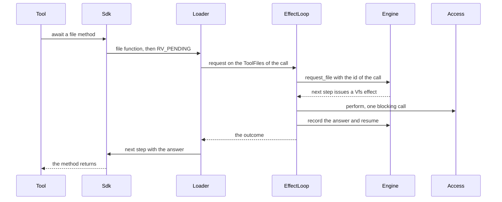

# Tool file operations as effects

## Start here

This section is for an agent that starts with this file and no earlier conversation.

- The workspace is `c:\Users\Vinnie\cursor`. Each repository named in this plan is a folder in it, and the shell is PowerShell on Windows.
- All of the code in this plan is still to be written. The newest commit in each repository is from 2026-11-15, and it changed comments and pages.
- Read the `AGENTS.md` of each repository before you change it.
- In `runvil-harness`, read [runvil-harness/decisions/files-and-the-vfs.md](runvil-harness/decisions/files-and-the-vfs.md), [runvil-harness/decisions/tools-and-packs.md](runvil-harness/decisions/tools-and-packs.md), [runvil-harness/decisions/engine.md](runvil-harness/decisions/engine.md), and [runvil-harness/decisions/harness-and-host.md](runvil-harness/decisions/harness-and-host.md). They state the code as it is, with the decisions of 2026-11-15. The decisions of 2026-11-16 and 2026-11-17 in this plan are newer than the pages, and this plan is the authority for them.
- For background written for a newcomer, read `cabinet/_output/report-tool-file-effects-plan.md` in the workspace. Where that report and this plan differ, this plan is right.

The repositories:

- `runvil-harness`: the Engine, the Harness, and the decision pages. `origin` is the owner's fork.
- `runvil-plugin-api`: the C contract and the SDK. `origin` is the owner's fork, and `upstream` is `cppalliance/runvil-plugin-api`. Local `master` tracks `upstream/master`.
- `runvil-plugin-std`: the `std` Pack. `origin` is the owner's fork, and `upstream` is `cppalliance/runvil-plugin-std`. Local `master` tracks `upstream/master`.
- `runvil-plugin-bashkit`: the `bash` Pack. `origin` is `cppalliance/runvil-plugin-bashkit`.
- `runvil-workshop`: the Host application. It stays as it is.

## Rules for all work

- Every commit goes on `master`, the one branch in use. After a commit passes its checks, push it with `git push origin master`. Pushing to `upstream`, merging, and tagging are the owner's.
- Before the first change in a repository, run `git status`. A tree with changes from outside this plan means stop and report.
- One step is one commit, unless the step says otherwise. Every commit builds and passes every check in the repository's `AGENTS.md`. In `runvil-harness`, a commit runs a format check, and a push runs the wording scan, clippy, and `cargo deny`.
- Write each commit message by `c:\Users\Vinnie\cursor\.cursor\rules\commit.mdc`, with its text free of any mention of this plan. End it with one trailer line: `Plan: /plan/2026-11-16-1-tool-file-effects.plan.md` in `runvil-harness`, and `Plan: runvil-harness/plan/2026-11-16-1-tool-file-effects.plan.md` in every other repository.
- A file that goes is moved to `c:\Users\Vinnie\cursor\cabinet\_trash\`. That move is the one way a file leaves a repository.
- Each change leaves one form of each thing. Compatibility code, aliases, and fallbacks stay out, and a test of a rule that goes is removed with the rule.
- Comments, crate docs, READMEs, error messages, and pages state the rule as it is, with its history left out. After the last commit of a package, search the lines you added for `no longer`, `formerly`, `previously`, `used to`, `legacy`, `deprecat`, `migrat`, `replaced`, `renamed`, and `changed`, and reword each hit.
- In the Engine crates, which are `runvil-engine` and the crates under `crates/runvil-internal`, docs and names say "the caller" for the code that steps a run. `node --test tools/docs-claims.mjs` checks this.
- A commit in `runvil-harness` edits the decision pages for every rule it changes. Quote the owner exactly. The quotes for the decisions of 2026-11-16 and 2026-11-17 are in this plan.
- When the code and this plan disagree, or a step fails as written, stop and report what you found. A small difference that the code settles goes into your report.
- End each package with a report: each commit with its hash and subject, each check with its result, and each point where the work differed from this plan.

## Work packages

The work is cut into packages, so that one agent holds one repository at a time. Each package can go to a fresh agent together with this file. The handoff is one sentence that names this file and the package: "Read the plan from 'Start here' through 'State', then do Package C." For Packages D, E, and F the sentence adds the merged hash.

- Package 0, the plan copy. Copy this file to `runvil-harness/plan/2026-11-16-1-tool-file-effects.plan.md`, commit it alone, and push. Every later package works from that copy.
- Package A, in `runvil-plugin-bashkit`: Step 1.
- Package B, in `runvil-plugin-api`: Steps 2 and 3. It ends with a push to `origin` and a report that gives the hash of its last commit.
- The owner's merge. When Package B has reported, the owner merges into `cppalliance/runvil-plugin-api` and names the commit that is on `upstream/master`. That hash goes under "State".
- Package C, in `runvil-harness`: Steps 4, 5, 6, and 7, in that order. It needs nothing from the contract, so it can run while Packages A and B run.
- Package D, in `runvil-harness`: Steps 8 and 9. It needs Package C and the merged hash. Its report starts with the numbers of the measurement in Step 8.
- Package E, in `runvil-plugin-std`: Steps 10 to 13. It needs the merged hash.
- Package F, in `runvil-plugin-bashkit`: Steps 14 and 15. It needs Package A and the merged hash.
- Package G, in `runvil-harness`, after every other package. It updates the `bash` and `std` entries of the tools page, completes "What the build found" in the plan copy from the reports of the packages, and marks the todos done.

Packages A, B, and C are in three repositories and can run at the same time, after Package 0. Packages D, E, and F can run at the same time for the same reason. Two packages in one repository run one after the other.

A fault in the contract that a later package finds goes back to `runvil-plugin-api` as a new commit. The owner merges it, the new hash goes under "State", and each repository that has pinned the contract moves its pin in a commit of its own.

Packages D, E, and F each start by confirming the merged hash: `git fetch upstream` in `runvil-plugin-api`, then `git branch -r --contains <hash>`, which must list `upstream/master`.

## State

Whoever hands out the packages keeps this section current in the plan copy.

The plan is built, and this section is its state on 2026-11-18. The rest of this file is the plan as it was handed out, so "Start here" describes the repositories before the work began. "What the build found", at the end, says where the build differs from the plan and lists the open questions.

- Merged contract commit on `cppalliance/runvil-plugin-api`: `52a4905aca0a9c945a93dc4ee7ea815db85612e4`
- Packages finished: 0, A, B, C, D, E, F, G. The commit that "Decided on 2026-11-17" places after Step 9 is finished too.

Where each repository stands:

- `runvil-plugin-api`. `master` of `cppalliance/runvil-plugin-api` and `master` of the fork `vinniefalco/runvil-plugin-api` are both at the merged contract commit, and the CI of `cppalliance/runvil-plugin-api` passed for it on Linux, Windows, and macOS. The tag `api-v0.5.0`, which the README names in its dependency lines, is not made.
- `runvil-plugin-bashkit`. Its three commits are on `master` of `cppalliance/runvil-plugin-bashkit`, which has no fork. `54746e0a7408f88e64fade193edcfdc201aa46e9` gives each call a shell (Step 1), `1c26d0485b003ddeab053915228a1282ef3e8be8` moves the driver to file futures (Step 14), and `f348f7a67b9087bcbc55ea7cb61c8de3fc409c82` lets the shell change files (Step 15). CI passed on Linux, Windows, and macOS for each.
- `runvil-plugin-std`. Its four commits are on `master` of the fork `vinniefalco/runvil-plugin-std`, one for each of Steps 10 to 13: `c7ee62cb29e359a3da57a28b90c000fda2fbd381`, `2ea8f8d0998e1189df73ac90841edcb7451ebe6e`, `caad57df163096fc136fbeb3285501a72764c796`, and `8f4d6c1c4fd35eb27ff2d30ca884a2e316d4b1b3`. `master` of `cppalliance/runvil-plugin-std` gets them with pull request 2.
- `runvil-harness`. Its commits are on `master` of the fork `vinniefalco/runvil-harness`. They are listed here by subject and in order, because a rebase merge gives each a new hash:
  - "Add the plan for tool file operations as effects" (Package 0)
  - "Move `VfsOp` to `runvil-vfs` as one list of operations" (Step 4)
  - "Issue a tool's file request as a `Vfs` effect" (Step 5, the Engine)
  - "Let a Pack ask for files through `ToolContext::files`" (Step 5, the runner)
  - "Run each call that changes files alone and in order" (Step 6)
  - "Check claims in a store only, not on the Host's files" (Step 7)
  - "Move the loader and the test Plugin to contract 0.5" (Step 8)
  - "Remove the access from `ToolCall` and `ToolContext`" (Step 9)
  - "Close the enums `VfsAsker`, `VfsOp`, and `VfsOutcome`" (after Step 9)
  - The commit of Package G, which holds this section.
- `runvil-workshop`. Unchanged, as the plan says. It pins the Harness, the SDK, and both Packs at commits from before this plan.

The two pull requests:

- https://github.com/cppalliance/runvil-plugin-std/pull/2, from `vinniefalco:master`, is open, and its CI passed on Linux, Windows, and macOS.
- The pull request from `vinniefalco:master` to `master` of `cppalliance/runvil-harness` is https://github.com/cppalliance/runvil-harness/pull/19, opened after the commit of Package G. It holds the ten commits above and one older commit, "Record the decisions on file operations and tool state", from 2026-11-15. Its first CI run passed all eleven jobs on the merge of the fork's head with `db4cf1f4`, with 4,026 tests passing on Linux.
- `master` of `cppalliance/runvil-harness` has one commit that the fork lacks: `db4cf1f4`, "Make existing Engine tests fail when the code they run is broken", merged there on 2026-11-16 from its pull request 1. A trial merge of it into the fork's `master`, made with `git merge-tree` on 2026-11-18, found no conflict. No one has run the tests of the two together, so the CI of the pull request is their first run. That repository takes rebase merges only.

Left for the owner:

- Merge the two pull requests, best together. The `std` Pack of pull request 2 loads only in a Harness that speaks contract 0.5, and `master` of `cppalliance/runvil-harness` speaks 0.4 until its pull request is merged. `master` of `cppalliance/runvil-plugin-bashkit` speaks 0.5 already.
- Make the tag `api-v0.5.0` on `cppalliance/runvil-plugin-api`.
- Move the four pins of `runvil-workshop` in one later change.
- Answer the open questions at the end of "What the build found".

## What this plan builds

A tool asks for a file operation and waits. The Engine issues an effect for it, the Harness performs it with one blocking call and records it, and a later step of the tool gets the answer.



A `store` call from Lua is a `Vfs` effect today and stays one. The two share one list of operations, and the effect says who asked.

## Decided on 2026-11-15

- Storage and `Access` stay synchronous. The Harness performs each file effect inline, with one blocking call.
- The `ToolCall` effect stays open until the tool returns its result. The Harness reports each file request through a new method on `Run`.
- The file-changing tools of one model reply run one after another, in the order the model listed them. A tool declares that it changes files.
- Each Shell call gets a new shell.
- Every commit goes to `master` and is pushed to `origin`, with a message written by `.cursor/rules/commit.mdc`.

## Decided on 2026-11-16

- Lua's `store` functions and a tool's file functions are two views of one list of operations, and the Engine uses the `Vfs` effect for both. The effect says who asked: the prompt's Lua, or a tool call. This replaces the effect kind and the operation type that this plan first gave to a tool. The owner's reason: "in principle, the store is just a virtual directory in the file system that is unique to a prompt."
- `store.mount` is left out of this plan. The owner's words: "I am not sure about the store.mount feature." A tool's file operations reach the Host's files alone, as today, and a store stays Lua's. A store therefore has Lua parties alone, and every conflict in one ends the run, as today.

## Decided on 2026-11-17

- The conflict check applies to a store alone. A conflict in a store ends the run with the code `determinism`, as today. The Host's files have no conflict check: an operation on them makes no claim and checks none, whoever asked for it, the prompt's own `tools.call` included. This replaces the rule of 2026-11-16, under which a conflict on the Host's files ended the run unless a model asked for both operations, and went back to the tool as an error when a model did.
  - The owner's reason: "maybe the determinism error should only apply to store operations? and we should otherwise try to behave like regular harnesses, so that two subagents which conflict on file access can just work it out".
  - On the prompt's own `tools.call`, the owner's words: "I think I am ok with Lua's own tools.call on Host files being unchecked. We can always put it back in later."
  - The store is the prompt's own memory, and every party in it is Lua, so the check stays there. The Host's files are the outside world: with a real folder mounted, another program can change a file, and the claims table knows the run's own identities alone.
  - Two tasks that work on one file both succeed. A reader in one task holds back no writer in another, and the later write is the content.
  - Replay stays whole, because every file operation is a recorded effect that the Harness performs in order.
  - One gap is known. A tool that edits a file as a read followed by a write can lose an edit that another task makes between the two. The VFS has an operation that replaces text in one step, `StrReplace`. A Rust Pack can ask for it through `ToolFiles`, and the C contract has no function for it, so the tools of `std` and `bash` cannot. Whether to add that function is the owner's to decide, and it is outside this plan.
- The owner merges the contract into `cppalliance/runvil-plugin-api` right after Phase 2, when its two steps are pushed. The loader is built after the merge, and the measurement runs once, in the loader's step, through the test Plugin. This replaces the decision of 2026-11-16 to prove the contract before the merge, which held uncommitted work in `runvil-harness` across the merge and made the `std` and `bash` Packs wait for the harness. Nothing uses the contract yet, so a fault that turns up later costs one more commit there and a move of each pin. The owner's words: "yes merge the contract right after phase 2".
- `VfsAsker`, `VfsOp`, and `VfsOutcome` are closed enums. They have no `#[non_exhaustive]`, so a variant added to one of them fails the build at each place that must handle it, as `Step`, `Effect`, and `EffectAnswer` do. The owner decided this late on 2026-11-17, after learning that the three were `#[non_exhaustive]`.
  - On the attribute, when the owner asked what it means: "I would expect that if they are extended, then all call sites should break, no?"
  - On the first two: "also VfsAsker, and VfsOp I think should fail to build if a new thing is added and call sites are not updated."
  - On the third, the owner first took `VfsOutcome` for an error type and wanted it open: "VfsOutcome sounds like an error type and I think it should be extensible without breaking builds." The owner was then told that `VfsOutcome` is the value a successful operation returns, that `VfsError` is the error type and is open already, and that a result kind the record code does not know is written as nothing. The owner's answer: "Yeah close VfsOutcome too."
  - What stays open. `VfsReceipt` keeps `#[non_exhaustive]`, because its own crate is the one place that matches on it. `VfsError` and every other type keep their attributes: an error type that can grow without breaking a build is what the owner asked for. The planned-work item on the error types of the Engine stays.
  - The rule for the code. A place that must decide what to do with each variant names every variant, with no wildcard arm and no catch-all binding: where an operation is performed, recorded, turned into a receipt, classified, sent to a Plugin, or answered. A place that takes the one variant its own operation gives, and treats any other as a mistake of whoever performed it, may keep its catch-all, because a new variant is a mistake there too.
  - This is one commit in `runvil-harness` after Step 9, outside the numbered steps. No other repository of this plan names the three enums in its code.

## Choices this plan makes

Each one is a default that is easy to change before the work starts.

- Names: `Run::request_file`, `VfsAsker`, `VfsReceipt`, `EffectAnswer::VfsReceipt`, `ToolFiles`, `ToolContext::files()`, `ToolInfo::changes_files`.
- What the record holds. Each `Vfs` record names who asked and which files the operation worked on: a store, by the id of its chain, or the Host's files. A write or an append records its bytes, as text when they are UTF-8 and as hex otherwise. An answer for Lua records the whole result, as today, because a replay resumes Lua with it. An answer for a tool records a size, the number of bytes of a read or the number of entries of a listing, and a stat's answer records the stat. The tool's own result is in the record as the answer of its `ToolCall`. A failure records its kind and message. The record holds no hash. Confidence: medium, because no reader of these records exists yet.
- The Engine reports no event for a tool's file operation. The effect record and the answer record are the view. A `store` call keeps its events.
- `runvil-vfs` is std only, and its manifest test enforces that, so `VfsOp` and `VfsOutcome` derive no serde there. The Engine's record code keeps a private serde form of each, which writes what the record holds today. The other place for the two types is `runvil-types`, with the function that performs an operation outside `runvil-vfs`. Confidence: medium, because the record form of `VfsOp` is serde's own today.
- `store.delete` succeeds on an absent path, and a tool's remove fails with `NotFound`. They are two operations of the list, `Delete` and `Remove`, so the record shows which one ran.
- The switch that turns the claims check off is private to `runvil-vfs`. A handle that a Host builds checks nothing, and a store asks for the check when it is made. The claims code and its tests stay, so that turning the check back on is one line. Confidence: medium, because the construction of a handle was read and the change is still to be built.
- The contract allows one request outstanding for each call. The SDK queues further requests and sends them in order.
- The contract has nine file functions and no `exists`, because a stat answers it.
- The shell answers `chmod` and `set_modified_time` inside the Plugin (Phase 5). Confidence: low, because bashkit's use of them is read from its source and untested.
- The SDK gets no adapter for synchronous tools.

## Out of scope

Glob in `std`, Workshop's pins, the classroom tutorial, `store.mount` and any other way for a tool to reach a store, approvals, a wake function, and a contract function for an edit as one operation. A coarser operation for Grep stays out unless the measurement of Step 8 calls for one, and then the owner decides. Workshop moves its four pins in one later change, because one build holds one version of the contract.

## Phase 1 - bashkit: a shell for each call

This phase is Step 1. It stays on SDK 0.4 and lands alone. Files: [runvil-plugin-bashkit/crates/plugin-bashkit/src/session.rs](runvil-plugin-bashkit/crates/plugin-bashkit/src/session.rs), [runvil-plugin-bashkit/crates/plugin-bashkit/src/pack.rs](runvil-plugin-bashkit/crates/plugin-bashkit/src/pack.rs), [runvil-plugin-bashkit/crates/plugin-bashkit/src/shell.rs](runvil-plugin-bashkit/crates/plugin-bashkit/src/shell.rs), [runvil-plugin-bashkit/crates/plugin-bashkit/schemas/shell.json](runvil-plugin-bashkit/crates/plugin-bashkit/schemas/shell.json).

- Remove `Session` and `turn`, and the `session` field of `BashPack`. `shell::call` builds a `Shell` for its call and drops it when the call ends.
- `shell.json`: the session bullet becomes "Each call starts a new shell at the root of the run's files. A `cd`, a variable, or a function lasts for that call alone." The bullet about calls sharing one session goes. `working_directory` defaults to the root of the run's files. The first line says "in a bash shell".
- The time-limit message in `shell.rs` loses its sentence about the session.
- `schemas/EDITS.md`, the crate docs in `lib.rs`, and `AGENTS.md` say the same. In `AGENTS.md`, the line that begins "Each call is to get a shell of its own" becomes the rule as built. The `bash` entry of the tools page changes in Package G, so that one agent at a time works in `runvil-harness`.
- Tests: a `cd` or a variable from one call is gone in the next. The tests of turns on the session go.

## Phase 2 - runvil-plugin-api: contract 0.5 and the SDK

Files: [runvil-plugin-api/crates/runvil-plugin-sys/src/lib.rs](runvil-plugin-api/crates/runvil-plugin-sys/src/lib.rs), [runvil-plugin-api/crates/runvil-plugin-sdk/src/tool.rs](runvil-plugin-api/crates/runvil-plugin-sdk/src/tool.rs), [runvil-plugin-api/crates/runvil-plugin-sdk/src/entry/tool.rs](runvil-plugin-api/crates/runvil-plugin-sdk/src/entry/tool.rs), [runvil-plugin-api/crates/runvil-plugin-sdk/src/entry/file.rs](runvil-plugin-api/crates/runvil-plugin-sdk/src/entry/file.rs), [runvil-plugin-api/crates/runvil-plugin-sdk/src/testing.rs](runvil-plugin-api/crates/runvil-plugin-sdk/src/testing.rs) and its `testing` folder.

### Step 2 - reads as a request and an answer

`RV_API_MINOR` becomes 5, and both crates become 0.5.0. Each file function only takes a request, and the answer arrives in the next step's arguments:

```rust
#[repr(C)]
pub struct RvFileAnswer {
    pub size: u32,
    pub status: RvStatus,      // RV_OK, or RV_ERR_FILE with `error` filled
    pub stat: RvStat,          // for file_stat
    pub entries: RvDirEntries, // for file_list
    pub bytes: RvBytes,        // for file_read
    pub error: RvFileError,
}

// In RvToolCallArgs, in their present positions:
pub file_stat: unsafe extern "C" fn(ctx: *mut c_void, path: RvStr) -> RvStatus,
pub file_list: unsafe extern "C" fn(ctx: *mut c_void, path: RvStr) -> RvStatus,
pub file_read: unsafe extern "C" fn(ctx: *mut c_void, path: RvStr, offset: u64, len: u64) -> RvStatus,
// Added after file_read: the answer to the request the call's last step made, or NULL.
pub answer: *const RvFileAnswer,
```

Rules for the contract's comment:

- A call has one request outstanding at a time. A second request in one step is a misuse, and so is a request in a step that calls `finish`.
- A step that made a request returns `RV_PENDING`. The Host sends that call its next step when the answer is ready, and no step before then.
- The answer, and what it points to, is valid for the step that receives it. The Plugin copies what it keeps.
- When the Host abandons a call, an operation it had taken either happened in full or did not happen.
- A file function returns `RV_OK` when the Host took the request and `RV_ERR_MISUSE` for a misuse, and it fills nothing. The sentence of the present comment that says only a file function returns `RV_ERR_FILE` changes, because that status now arrives in the answer.
- The sentence of the present comment that says `RV_PENDING` is not a way to wait changes too: a step that made a request waits for its answer by returning `RV_PENDING`.
- `RV_FILE_ERROR_CONFLICT` and its comment stay as they are. This Host checks no conflict on the files a tool reaches, so it sends that kind to no tool.

SDK:

- `ToolCall::stat`, `list`, `read`, and `read_range` return futures that are `Send`. Each copies its path when it is made.
- `CallState` holds a queue behind a `std::sync::Mutex` in place of the step pointer: requests not yet sent, whether one is with the Host, and answers not yet taken.
- In `entry/tool.rs`, each step copies `args.answer` into the queue before it polls the tool's future. After a poll that returns `Pending`, the step sends the oldest queued request through the step's file function. Sending after the poll means a tool that finishes or panics in that poll leaves no request with the Host.
- A file future dropped before its request went out sends nothing. Dropped later, the operation still happens and its answer is discarded. The docs say both.
- The `unsafe` stays in `entry` and `testing`, and the crate still builds on Rust 1.85.

Fake Host: a `Call` keeps the outstanding request and its answer between steps, and it checks the new misuses. The loader copies its words for each misuse in Phase 3.

Also: `cargo xtask header`, the tables in `tests/c-layout`, `examples/hello-plugin`, `README.md`, and the file rule in `AGENTS.md`. The dependency lines in the README name the tag `api-v0.5.0`, and the owner creates that tag after the merge.

### Step 3 - changes and the flag

- `file_write(ctx, path, bytes)`, `file_append(ctx, path, bytes)`, `file_mkdir(ctx, path, recursive)`, `file_remove(ctx, path, recursive)`, `file_rename(ctx, from, to)`, and `file_copy(ctx, from, to)`, added after `answer`. Their answer holds a status alone. `RV_MAX_WRITE` is 16 MiB. `recursive` is a `u32` that is 0 or 1, and bytes longer than `RV_MAX_WRITE` are a misuse.
- A remove of a path that is absent answers `RV_FILE_ERROR_NOT_FOUND`.
- Two error kinds: `RV_FILE_ERROR_ALREADY_EXISTS` (7) and `RV_FILE_ERROR_NOT_EMPTY` (8).
- `RvToolInfo.reserved` becomes `flags`, and `RV_TOOL_CHANGES_FILES` is bit 0. A set bit outside the defined ones is a misuse.
- SDK: `ToolCall::write`, `append`, `mkdir`, `remove`, `rename`, `copy`, `ToolInfo::changes_files()`, and the two new `FileErrorKind` values.
- `testing::Files` becomes a tree that the calls of one `PackRun` share and can change, and a test reads it back after a call. `Files::fails` makes every operation on its path fail, a change included, so that a test can show a write that the Host refuses. Phases 4 and 5 need this for their tests.

Then push to `origin`. The owner merges the contract at this point, and the later pins use the commit that is on `cppalliance/runvil-plugin-api` after the owner's merge.

## Phase 3 - runvil-harness

Each commit keeps the workspace building, and each edits the decision pages for what it changes. Engine docs say "the caller", as `tools/docs-claims.mjs` requires.

### Step 4 - one list of operations, in `runvil-vfs`

`VfsOp` and `VfsOutcome` move from [runvil-harness/crates/runvil-internal/lua/src/protocol](runvil-harness/crates/runvil-internal/lua/src/protocol) to a new module of [runvil-harness/crates/runvil-internal/vfs/src](runvil-harness/crates/runvil-internal/vfs/src) beside `stat.rs`, and they grow to the whole list. `Access::perform` in `handle/operations.rs` runs one operation. The line-range logic of `run_store_op`, in `engine_globals_store.rs` of `runvil-lua`, moves with it, and the facade's `perform_vfs_op` calls `Access::perform`. The rule that an anchor occurs exactly once is in `runvil-vfs` already.

The eight operations that exist keep their names and the form of their records:

- `Write`: creates a file or replaces its content. Lua uses it for `store.write`, and the contract for `file_write`.
- `Append`: adds to the end of a file and creates the file when needed. Lua uses it for `store.append`, and the contract for `file_append`.
- `Read`: a range of lines as text. Lua uses it for `store.read`.
- `ReadNumbered`: a range of lines with their numbers. Lua uses it for `store.read_numbered`.
- `StrReplace`: replaces a text that occurs exactly once in a file. Lua uses it for `store.str_replace`.
- `Delete`: removes what a path names, and succeeds when the path is absent. Lua uses it for `store.delete`.
- `Glob`: the paths that match a pattern. Lua uses it for `store.glob`.
- `Exists`: whether a path exists. Lua uses it for `store.exists`.

Seven operations join them:

- `Stat`: the type and the length of what a path names. The contract uses it for `file_stat`.
- `List`: the entries of a directory. The contract uses it for `file_list`.
- `ReadRange`: a range of bytes. The contract uses it for `file_read`.
- `Mkdir`: creates a directory, with its parents on request. The contract uses it for `file_mkdir`.
- `Remove`: removes a file or a directory, with its content on request, and fails with `VfsError::NotFound` when the path is absent. The contract uses it for `file_remove`.
- `Rename`: moves a file or a directory. The contract uses it for `file_rename`.
- `Copy`: copies one file. The contract uses it for `file_copy`.

The list has fifteen operations. Lua uses eight and a tool uses nine, and `Write` and `Append` are on both sides. The Engine and the Harness handle the whole list from the start, so either side gains an operation later by adding one function.

One field changes: the `contents` of `Write` and `Append` becomes bytes, where it is a string today, because a tool writes bytes. Lua passes the bytes of its string, and the record writes them as the text it writes today. `VfsOutcome` gains the results the new operations need: a stat, a list of entries, and bytes, beside the unit, text, paths, and bool it has.

### Step 5 - a tool's requests as `Vfs` effects, beside the old access

Step 5 is two commits. The first holds the Engine changes, with the runner adjusted so that the workspace builds: its match on `Effect::Vfs` takes the new field. The second holds the Rust Plugin API, the runner's desk and loop arm, and the tests under `Harness::run`.

Engine, in [runvil-harness/crates/runvil-internal/runtime/src/execute/run/effect.rs](runvil-harness/crates/runvil-internal/runtime/src/execute/run/effect.rs), [runvil-harness/crates/runvil-internal/runtime/src/execute/run.rs](runvil-harness/crates/runvil-internal/runtime/src/execute/run.rs), and `effects.rs`, `apply.rs`, `drive.rs`, `tool_call.rs` under [runvil-harness/crates/runvil-internal/runtime/src/execute/scheduler](runvil-harness/crates/runvil-internal/runtime/src/execute/scheduler):

```rust
// Run
pub fn request_file(&mut self, call: EffectId, op: VfsOp);
// Effect: `asker` takes the place of today's `store` field
Vfs { asker: VfsAsker, access: Arc<Access>, op: VfsOp },
pub enum VfsAsker {
    /// A `store` call of the prompt's Lua, on the store made for this chain.
    Lua { store: ChainId },
    /// The open tool call with this id, on the Host's files.
    Tool { call: EffectId },
}
// EffectAnswer
Vfs(Result<VfsOutcome, VfsError>),        // when Lua asked, as today
VfsReceipt(Result<VfsReceipt, VfsError>), // when a tool asked
```

- Without `store.mount` the asker settles the files: Lua works on its chain's store, and a tool works on the Host's files. The effect needs no second field for the files.
- `ToolCallContinuation` keeps the call's `Arc<Access>`.
- `request_file` for an awaited tool call issues a `Vfs` effect whose asker is that call, under the calling chain, with the call's access, and the next `step` returns it. For a call whose chain stopped waiting it does nothing. For any other id it ends the run with an `internal` error, as a bad answer does.
- A new continuation for a tool's `Vfs` effect resumes no chain, like a fired timer. Its `Dropped` answer does nothing either. A failure in its answer goes to the tool and leaves the run alone.
- A `Vfs` effect that Lua asked for is answered with the whole outcome and resumes the Lua code, as today.
- `VfsReceipt` is what the record keeps of a tool's outcome: a stat, a bool, a count of entries or paths, a count of bytes, or done. It covers all fifteen operations, because a Rust Pack may ask for any of them through `ToolFiles`. The loop hands the full outcome to the tool, so the Engine gets no copy of the bytes of a read.
- `Effect::record` and `EffectAnswer::record` gain the forms listed under "Choices this plan makes". The record of a `Vfs` effect that Lua asked for stays byte for byte as it is. A test that names the effect's `store` field changes with the field. The record of one that a tool asked for names the tool call by its effect id, where the other names its store.
- `request_file` on a run that has returned `Done` does nothing.
- An answer of the other form, such as `Vfs` for an effect that a tool asked for, ends the run with an `internal` error, as an answer of the wrong kind does today.
- The facade in [runvil-harness/crates/runvil-engine/src/lib.rs](runvil-harness/crates/runvil-engine/src/lib.rs) re-exports the new items, and `cargo +<nightly> xtask api --bless` updates both `public-api.txt` listings. The `runvil` facade and `runvil-plugin` re-export `VfsOp`, `VfsOutcome`, and `ToolFiles` as well, because a Pack names them through `ToolContext::files()`.

Rust Plugin API, in [runvil-harness/crates/runvil-plugin/src/context.rs](runvil-harness/crates/runvil-plugin/src/context.rs):

```rust
pub trait ToolFiles: Send + Sync {
    fn request(&self, op: VfsOp) -> BoxFuture<'_, Result<VfsOutcome, VfsError>>;
}
```

`ToolContext::files()` lends it. `testing::TestCall` answers each request at once from a file system of its own.

Runner, in [runvil-harness/crates/harness-internal/runner/src/effect_loop.rs](runvil-harness/crates/harness-internal/runner/src/effect_loop.rs), `performers.rs`, `packs.rs`, and a new `tool_files.rs`:

- Each tool call gets a desk that implements `ToolFiles`: a queue of its requests with the waker of each, plus a run-wide queue of the calls that asked.
- `wake()` gains an arm that returns the next request. It checks the queue before and after it polls the calls in flight.
- For a request from a call still in flight, the loop calls `run.request_file`. A request from a call that has landed or was aborted is dropped.
- A `Vfs` effect that a tool asked for is answered inline: `access.perform(&op)`, then the answer record, then `run.resume` with the receipt, then the full outcome goes to the call's desk and wakes the call. A withdrawn one is answered `Dropped` unperformed, on the path that exists for store effects. The loop performs the operation inside a guard that turns a panic in a backend into `VfsError::Backend`, as `contained` in the loader does today.
- A `Vfs` effect that Lua asked for is answered as today.
- `ToolPerformer::call` gains the desk, and `RunPacks::call` puts it in the `ToolContext`.

Tests: the Engine's rules above, one each, and a Rust fixture Pack that reads and writes through `cx.files()` under `Harness::run`, with the records checked, and with a stop and a cancel while a request is pending.

### Step 6 - file-changing tools run in order

The Host's files have no conflict check, so this order is what keeps two changes of one reply from interleaving: each changing call finishes before the next one starts.

- `ToolInfo::changes_files` in `runvil-types`, and `ToolBinding::changes_files()` in `runvil-lua`. A render keeps the catalog's value, as it keeps `survives_stop`.
- One more arm in `dispatch_tool_calls` in `tool_call.rs`, so that such a call ends the batch before it and the loop sends it alone, as it sends an adhoc tool:

```rust
Ok(ToolRoute::Adhoc(_) | ToolRoute::Discovery(_)) => break,
Ok(ToolRoute::Catalog(binding)) if binding.changes_files() => break,
```

- Tests: two edits to one file in one reply both apply, in the order listed. A reader listed before a changer finishes first. Tools without the flag still overlap.

### Step 7 - no conflict check on the Host's files

Files: `handle.rs`, `handle/access.rs`, and `handle/store_view.rs` under [runvil-harness/crates/runvil-internal/vfs/src](runvil-harness/crates/runvil-internal/vfs/src), the tests beside them, and the tests outside the crate that expect a conflict on the Host's files.

- The `Volume` of a handle says whether it checks claims. `Access::admit` in `handle/access.rs` skips the claim when it does not, and it still refuses an operation of a scope that has ended.
- A handle from `VfsRef::new` or `VfsRefBuilder::build` checks no claims. `Store::new` asks for the check through a setting that is private to the crate. No public item is added.
- Identities, scopes, forks, and joins stay as they are, because a store view takes its order from them.
- The claims code, the case folding of claim keys, and the claims tests of `runvil-vfs` stay. Those tests build their handles with the private setting. The owner may turn the check back on: "We can always put it back in later."
- A `store` conflict ends the run with `determinism`, as before, and `classify_vfs_failure` stays as it is.
- Tests outside `runvil-vfs` that expect a conflict between two accesses of the Host's files change to expect that both operations run. The compiler does not find them, so search the tests for `Conflict` and `conflict`, starting with `execute/tests/tool_call_access.rs` of the runtime and the `vfs.rs` suites of `runvil` and `runvil-engine`. A test of a conflict in a store stays.
- New tests, with the Rust fixture Pack. Two tasks whose models write one path both succeed, and the later write is the content. A task whose model reads a path holds back no write of another task. A prompt's own `tools.call` and a model's call on one path both succeed. A `store` conflict ends the run as before.
- The docs of the methods of `Access` say that a conflict is refused on a handle that checks claims.

### Step 8 - the loader and the test Plugin on 0.5

This step follows the owner's merge. Files: [runvil-harness/Cargo.toml](runvil-harness/Cargo.toml), `file.rs`, `call.rs`, `session.rs`, `pack.rs` under [runvil-harness/crates/harness-internal/plugin-loader/src](runvil-harness/crates/harness-internal/plugin-loader/src), and [runvil-harness/crates/harness-internal/test-plugin/src/lib.rs](runvil-harness/crates/harness-internal/test-plugin/src/lib.rs).

- Pin `runvil-plugin-sys` 0.5 at the merged commit: in [runvil-harness/Cargo.toml](runvil-harness/Cargo.toml), the line takes `version = "0.5.0"` and the merged commit as `rev`, with the `git` address it has today, and `Cargo.lock` follows.
- Each file function records one `VfsOp` in the step's session. The misuses and their words are the fake Host's, in `runvil-plugin-api/crates/runvil-plugin-sdk/src/testing`.
- `Steps` holds the call's `ToolFiles`, the request in progress, and the answer to lend. Its `poll` first polls a request in progress, and returns `Pending` without waking itself while that request waits. It then sends one step with `answer` set. A step that made a request starts that request and polls it at once. A step that returns `RV_PENDING` with no request wakes itself, as today.
- `describe` in `file.rs` maps the two new kinds. `contained` leaves the loader, because the loop performs the operations.
- `pack.rs` reads `RV_TOOL_CHANGES_FILES` into `ToolInfo::changes_files`.
- The test Plugin reports 0.5. Its `stat`, `list`, and `read` tools take two steps, and it gains a tool for each change, flagged. It also gains a tool that reads many small files in one call, for the measurement.
- End-to-end tests under `Harness::run`: each operation, a denied one, two tasks that write one path, and a cancel between a request and its answer.
- The measurement. A test that is ignored by default calls the test Plugin's tool that reads many small files, for 100,000 reads under `Harness::run` with `MemoryRecorder`, and prints the elapsed time and the record count. The numbers go into the plan copy under "What the build found", in this step's commit, and into the report of Package D. They say whether Grep needs a coarser operation, which would be an addition to the contract, and the owner decides.

### Step 9 - remove the old access

Remove `access` from `Effect::ToolCall`, `ToolContext::access`, the access argument of `ToolPerformer::call`, and the `Access` re-export of `runvil-plugin`. Rewrite the tests that used them: `execute/tests/tool_call_access.rs` in the runtime, `tests/it/tool_context.rs` in the runner, and the `vfs.rs` suites of `runvil` and `runvil-engine`. The drivers in `examples/greeter.rs` and the two `scenario.rs` files answer a `Vfs` effect that a tool asked for. Bless both listings.

### Pages

Packages C and D edit these pages in the commits of the steps they describe. Package G edits the entries of the shipped Packs on the tools page: the `bash` entry says that each call has a shell of its own and that the shell can change files, the `std` entry says that Write, StrReplace, and Delete work, and the planned-work items for these go.

- [runvil-harness/decisions/engine.md](runvil-harness/decisions/engine.md): `Run` has five calls. The Engine still has five effect kinds, and the entry for `Effect::Vfs` says who asked and what each record holds. The sentence "`EffectAnswer` has one variant for each effect kind, plus `Dropped`" changes with Step 5, because the `Vfs` kind then has two answers: `Vfs` when Lua asked and `VfsReceipt` when a tool asked.
- [runvil-harness/AGENTS.md](runvil-harness/AGENTS.md): the definition of the Engine lists "a store operation" among the work it issues effects for. With Step 5 it says a file operation, which covers a `store` call and a tool's request.
- [runvil-harness/decisions/files-and-the-vfs.md](runvil-harness/decisions/files-and-the-vfs.md): the entry on a tool call's identity, the entry that says a tool's operations will be effects, and the two entries on the `Vfs` effect and its record. The entries on identities and conflicts say that the claims check applies to a store alone and that the Host's files have none, with the owner's reasons from 2026-11-17, which answers open question 4.
- [runvil-harness/decisions/tools-and-packs.md](runvil-harness/decisions/tools-and-packs.md): tool calls in order, `ToolContext`, the contract section, the entry on a call's file identity, which loses its conflict rule, and open question 7.
- [runvil-harness/decisions/harness-and-host.md](runvil-harness/decisions/harness-and-host.md): the loop answers every `Vfs` effect inline, for Lua and for a tool, and what the records hold.
- `tasks-and-fanout.md` and `testing-and-debugging.md`: one sentence each, on the order of file requests and on the fake Host's tree.

## Phase 4 - runvil-plugin-std

This phase waits for the owner's merge, which follows Phase 2, and it needs no code from Phase 3. Files: [runvil-plugin-std/crates/plugin-std/src/source.rs](runvil-plugin-std/crates/plugin-std/src/source.rs), [runvil-plugin-std/crates/plugin-std/src/pack.rs](runvil-plugin-std/crates/plugin-std/src/pack.rs), `read.rs`, `dir.rs`, `dir/walk.rs`, `grep/find.rs`, `fake.rs`, and the `schemas` folder.

- Step 10. Pin SDK 0.5: in `Cargo.toml`, the line for `runvil-plugin-sdk` takes `version = "0.5.0"` and the merged commit as `rev`, and `Cargo.lock` follows. The methods of `Source` become `async fn`. `read::call`, `read_file`, `dir::call`, `list_directory`, `walk`, `Search::root_file`, and `Search::visit` become async, and `walk` takes the `Source` in place of its closure. Grep keeps its pause every 32 entries and drops the one every 2 MiB.
- Step 11. Write: one `write`, flagged `changes_files`. Contents over the SDK's write limit fail with a sentence that names the limit.
- Step 12. StrReplace: read the file under the 16 MiB ceiling that Read has, require UTF-8, find `old_string`, and write the result. It needs exactly one match unless `replace_all` is set, and a failure states the count.
- Step 13. Delete: a `stat`, then one `remove`. The stat comes first because a directory is refused with a sentence.
- Each step updates its schema text, `schemas/EDITS.md`, the crate docs, and its tests, which use the SDK's fake Host or `FakeSource`. The `std` entry of the tools page changes in Package G.
- [runvil-plugin-std/AGENTS.md](runvil-plugin-std/AGENTS.md) changes with the steps. Step 10 takes "every 2 MiB read" out of the rule on long jobs. Steps 11 to 13 widen the rule on `Source` from reads to every file operation, and they remove the line that says what Write, StrReplace, and Delete wait for.

## Phase 5 - runvil-plugin-bashkit on 0.5

This phase follows Phase 1 and waits for the owner's merge. Files: [runvil-plugin-bashkit/crates/plugin-bashkit/src/files.rs](runvil-plugin-bashkit/crates/plugin-bashkit/src/files.rs) and `session.rs`, `pack.rs`, `shell.rs`, `schemas/shell.json` beside it.

Step 14 - the driver over futures. Changes are still refused. The step starts with the pin: in `Cargo.toml`, the line for `runvil-plugin-sdk` takes `version = "0.5.0"` and the merged commit as `rev`, and `Cargo.lock` follows.

- `FileRequest::serve` becomes async and awaits the SDK's future.
- `drive` keeps the operations in progress in its own frame and polls them before it polls the script.
- It drops a request whose asker is gone, tested with `reply.is_closed()`. bashkit abandons a file operation at its `timeout` builtin, at `kill`, and in a failed pipeline.
- It waits for the operations in progress before the call ends.
- The count of 32 becomes a cap on polls of the script in one step.

Step 15 - writes.

- `write_file`, `append_file`, `mkdir`, `remove`, `rename`, and `copy` forward to the SDK, and `READ_ONLY` goes.
- The shell reports mode 0o644 for a file and 0o755 for a directory. `chmod` succeeds when it sets the mode the shell reports for that path and fails with one fixed sentence otherwise. `set_modified_time` succeeds and stores no time, because the run's files report no times. `symlink` and `mkfifo` answer `Unsupported`, as `read_link` does today.
- A write to a path under `/dev/` is refused, because bashkit 0.21.0 on Windows sends a redirect to `/dev/stdout` to the file system. The `AGENTS.md` of this repository asks for a link to an upstream issue beside a workaround, and the owner supplies that link.
- `Shell` is flagged `changes_files`, and `shell.json` says that a reply's Shell calls run one after another, in the order listed.
- Tests: a redirect, `>>`, `tee`, `sed -i`, `cp -r`, `mv`, `rm -r`, `mkdir -p`, `touch`, `mktemp`, and a write that the Host refuses.
- `schemas/EDITS.md`, the crate docs, and `AGENTS.md` follow. The `bash` entry of the tools page changes in Package G.

## Order of work

The section "Work packages" maps this order onto packages.

- Phases 1 and 2 start together, and so do Steps 4 to 7, which need nothing from the contract.
- The owner merges the contract when Phase 2 is pushed.
- After the merge, Steps 8 and 9, Phase 4, and Phase 5 are in three repositories and can run side by side. Step 8 follows Step 7.

## Verification

- `runvil-plugin-api`: `cargo test --workspace --all-features`, clippy with `CARGO_BUILD_WARNINGS=deny`, `cargo fmt --all --check`, the docs build with `RUSTDOCFLAGS="-D warnings"`, and `cargo +1.85 check -p runvil-plugin-sys -p runvil-plugin-sdk --all-features`.
- `runvil-harness`: `cargo nextest run --locked --workspace --all-features`, clippy, fmt, both docs builds, `cargo +<nightly> xtask api --check`, `cargo dylint`, `cargo test -p build-xtask`, and `node --test tools/docs-claims.mjs`.
- `runvil-plugin-std` and `runvil-plugin-bashkit`: the test, clippy, fmt, docs, and release-build commands in each `AGENTS.md`.

## What the build found

The design held. Every step is built, and no package found a fault in the contract or the SDK, so the commit that the owner merged right after Phase 2 is the contract that every later package pinned. The measurement of Step 8 comes first. After it, this section lists the other numbers that were measured, each place where the build differs from the plan, each choice made where the plan was silent, what is known and not tested, and the open questions for the owner.

### Step 8: the measurement of 100,000 reads

One call of the test Plugin's `read_many` tool read 100,000 files of 15 bytes each under `Harness::run`, with `MemoryRecorder` and the files in memory. The tool asks for one file in each step, so the call made 100,000 file requests, and the Harness performed and recorded each one as a `Vfs` effect.

- Release build: 0.73 seconds for the run, which is 7.3 microseconds for each read.
- Debug build: 2.65 seconds for the run, which is 26.5 microseconds for each read.
- Records: 200,012 in each build. Each read is two records, its effect and its answer, and the rest of the run is 12 records.
- Spread: three runs of each build took 0.725 to 0.730 seconds and 2.64 to 2.68 seconds, on a Windows machine that was building other repositories at the same time.
- Left out: what a Host adds for each record and each read, which is a recorder that writes to a database and a file system over a real directory.
- The test: `measure_100_000_reads_of_one_library_tool_call_under_the_harness` in `crates/harness-internal/test-plugin/tests/it/run.rs`. It is ignored by default. `cargo nextest run -p harness-test-plugin --run-ignored ignored-only --no-capture` runs it in a debug build, and the same command with `--release` runs it in a release build.

A Grep over 100,000 files therefore spends under one second of a release build on its file requests, and its run holds two records for each file it reads. Whether that count of records calls for a coarser operation is the owner's decision.

### Other numbers that were measured

- **Tests in `runvil-harness`.** The workspace runs 4,023 tests, all passing, and skips 25, one of which is the measurement. It ran 3,928 before Step 4 and skipped 24. After the five commits of Steps 4 to 7 it ran 3,944, 3,961, 3,975, 3,981, and 3,993. The structural checks run 204 tests and ignore 21.
- **Tests in `runvil-plugin-api`.** 201 after Step 3: 170 in the SDK, 19 in `runvil-plugin-sys`, 7 in the xtask, 3 in `c-layout`, and 2 in `hello-plugin`. After Step 2 the SDK had 137 and `runvil-plugin-sys` had 18.
- **Tests in `runvil-plugin-std`.** 497 after Step 13: 10 in `build-checks`, 445 unit tests, and 42 integration tests. It ran 419 before Step 10.
- **Tests in `runvil-plugin-bashkit`.** 87 after Step 15: 10 in `build-checks`, 76 unit tests, and 1 integration test. The unit tests were 48 before Step 1, 46 after it, and 52 after Step 14.
- **Requests of the `std` tools.** Each file request ends a step of its call. Write makes one request, Delete two, and StrReplace three. A Grep over 1,000 files in one directory takes 1,033 steps before the one that answers: the stat of the root, its listing, one read for each file, and a pause after each 32 files.
- **Steps of a Shell call.** Counting the last step, `echo hi` takes 1 step, a `cd` 2, `cat f` 2, `ls dir` 3, `grep -rn` over three files 7, and `cat` of 40 files 42. A new shell makes no file request of its own. `chmod` costs one stat, and a `mkdir -p` of a directory that is there costs a stat after its `mkdir`.
- **bashkit's limits, read in bashkit 0.21.0.** A shell allows 1,000 scripts and 100,000 commands, and one script allows 10,000 commands. A shell for one call runs two scripts at most, so it cannot reach the limits of a shell.
- **Tests that hold a rule fail without it.** With the batch arm of Step 6 off, the order tests fail. With the claims check back on for a handle that a Host builds, exactly the 14 tests that Step 7 added or changed fail. In the bash Pack, tests fail when any one of these rules is off: the drop of a request whose asker is gone, the wait at a script's end, the cap on polls, the refusal under `/dev/`, the write limit, the `mkdir -p` rule, and `chmod`.

### Where the build differs from the plan

The contract and the SDK, Steps 2 and 3:

- **`examples/hello-plugin` is unchanged.** Step 2 lists it, and it names no contract version and calls no file function.

The Engine and the runner, Steps 4 to 7:

- **The `runvil` facade re-exports `VfsOp` and `VfsOutcome` from Step 4 on.** The plan puts these re-exports in Step 5. `Access::perform` names both types, and the surface check refuses a listing that names an item its facade does not re-export.
- **`perform_vfs_op` takes `&VfsOp`, where it took the operation by value.** The plan does not name this change to the facade. `Access::perform` borrows the operation, and clippy refuses a function that takes by value what it only reads.
- **More `Vfs` effects of a tool are answered `Dropped` unperformed than the plan names.** The plan names a withdrawn effect. The loop answers the same way for an effect whose call has landed or was dropped, because that call has no desk to take the outcome.
- **A stop and a cancel are tested at two moments each**, because the loop handles a request inside one poll. Raised as the call asks, either one drops the call, and the loop answers the call's file effect `Dropped` unperformed. Raised as the record of the effect is written, the operation is still performed and recorded, then the call is dropped, and its next request is never issued.
- **On a handle that checks no claims, `admit` refuses an ended identity as well as an ended scope.** The plan names the scope alone. The Engine relies on the refusal of an ended identity when a tool call ends.
- **Two tests outside `runvil-vfs` asserted a conflict on the Host's files**, one each in the suites of `runvil` and `runvil-engine`, and both now expect both operations to run. In `tool_call_access.rs`, where the plan says to start, no test asserted a conflict, and several used one to show the order of identities. Their driver now notes each call in a `Store` under the identity of the call, so a missing fork or join still fails them.
- **One claims test of `runvil-vfs` shows its point through a store view.** It needs a backend that `VfsRef::new` wraps directly, which the private setting of the builder cannot give.

The loader and the old access, Steps 8 and 9:

- **`TestCall` lends no access.** A test of a Plugin crate seeds a file and reads it back with a request through the files of `context()`. `plugin-web` and `plugin-mcp` needed no change.
- **Step 9 fixed two doc comments outside its list**, in `params.rs` of the runtime and in `scope_handle.rs` of `runvil-vfs`. Each said that a tool call has an access.

The pages:

- **More sentences changed than the "Pages" section lists.** Step 7 changed the determinism entry of `tasks-and-fanout.md`, which said that the file system decides a conflict and now says that a store does. Step 9 changed two sentences in `harness-and-host.md` and one in `testing-and-debugging.md`, which said that a tool call or the test helper has an access. The commit that closed the three enums took the date out of the entry on the error types in `engine.md`, because the rule that the entry cites now names six closed enums.
- **The planned-work items that this plan built are gone.** Step 9 removed three, on the engine, files, and tools pages, and Package G removed two on the tools page. Open question 4 of the files page and open question 7 of the tools page are gone too, and the later questions of the tools page have new numbers.

The `std` Pack, Steps 10 to 13:

- **StrReplace asks for a stat before its read, so an edit is three requests.** The plan gives a read and a write. StrReplace loads the file with the function that Read uses, so both tools refuse the same paths in the same sentences, and neither opens a pipe or a device, whose read can block the run.
- **The line of `AGENTS.md` on what the three tools wait for changed from Step 10 on.** The plan has Steps 11 to 13 remove it. It was false once `Source` was async, so Step 10 reworded it, and Step 13 removed it.

The bash Pack, Steps 14 and 15:

- **The test of a request whose asker is gone is in `relay`, in `files.rs`.** The plan puts it in `drive`. The reply sender moves into the future of `serve`, so `drive` cannot reach it. `relay` asks `reply.is_closed()` before each poll of the SDK's future, and `drive` drops each operation that ended.
- **Everything that is not a directory shows mode 644**, a link included. The plan names a file and a directory alone.
- **The test of `sed -i` on a write that fails uses a file under `/dev/`.** The SDK's fake Host cannot refuse a write to a path while it allows the read of that path, so in a test the Host by itself never refuses the write of `sed -i`. `tee` is tested on a path that the Host denies.
- **The low-confidence choice on `chmod` and `set_modified_time` held.** bashkit does ask for both: `sed -i` sets its temporary file to the mode of its target, `cp -r` sets the mode of a new directory and ignores the result, and `touch` sets a time.

The workspace:

- **Local `master` of `runvil-plugin-api` tracks `origin/master`.** "Start here" says `upstream/master`. Both are at the merged contract commit.

### Choices made where the plan was silent

The contract:

- **The unused fields of an answer are zero.** Every field of an `RvFileAnswer` that the request does not name is zero, and the SDK depends on it.
- **A write makes the missing directories.** `file_write`, `file_append`, `file_rename`, and `file_copy` make each absent directory on the way to their path, as both backends of the Harness do. Write in `std` as one `write` assumes it.
- **Links.** `file_mkdir`, `file_remove`, and `file_rename` act on a link itself, and the other functions act on what it leads to, as the real backend does.
- **`file_mkdir` on a path that exists fails as `RV_FILE_ERROR_ALREADY_EXISTS`**, with `recursive` 1 too, as both backends do.
- **The flag has a type and a stated meaning.** `RvToolFlags` is the type of `RvToolInfo.flags`, and the contract says that the Host runs a call of a flagged tool by itself among the calls of one model reply.
- **A request in a step that does not return `RV_PENDING` is not performed.** The call fails, as a call with such a step did before, in the fake Host and in the loader. The comment of the contract has no sentence on this case.

The SDK and its fake Host:

- **The file methods return one future type, `FileFuture<'a, T>`**, which is exported, `Send`, and `Unpin`. A request joins the queue at the first poll of its future, so the requests of a call go out in the order of first polls.
- **Two failures never reach the Host.** A path over 4,096 bytes, or bytes over `RV_MAX_WRITE`, fails the future in the SDK. An answer that breaks the contract fails the waiting future with a `FileError` that says what was wrong, and the call goes on.
- **The fake Host performs a request once the step that made it has returned `RV_PENDING`.** The operations of calls that take turns happen in the order asked, and the request of a call that a test then abandons has happened.
- **`Files::fails` covers what would be made under its path.** A change that would make something under a failing path fails with the same error, and a read under it answers not found.
- **The fake Host words a change to the root by itself.** It says "the root / cannot be removed or moved, and nothing can be moved onto it". The Harness's sentence has two words that the word scan of "Rules for all work" lists.
- **The fake Host does not check the flag.** It takes a change from a tool that does not set `RV_TOOL_CHANGES_FILES`.
- **The loader's words for each misuse are the fake Host's.** The sentences about a NULL or misaligned pointer that the three read functions had are gone, because a file function fills nothing.

The Engine and the Harness:

- **What a record holds beyond the list under "Choices this plan makes".** A write or an append records UTF-8 bytes as text under `contents` and other bytes as hex under `contents_hex`. A stat records each time as whole seconds and nanoseconds from the Unix epoch. The asker is one key beside `op`: `store` with a chain id, or `call` with the effect id of the tool call. The record of a `store` call is the same JSON as before.
- **The record code has no fallback.** With the three enums closed, every operation and every outcome has a record form, and a recorded `null` in the place of one fails to read with serde's own error. A kind of file that has no name records as `other`.
- **`VfsReceipt` keeps `#[non_exhaustive]`.** Its own crate is the one place that matches on it, and the attribute asks no wildcard arm there.
- **One catch-all stays in production code.** In the loader, an outcome that the request did not ask for becomes a failed answer, so a step never reads a field that the operation did not fill. A new outcome is such an outcome there.
- **`ToolInfo::changes_files` has no serde default**, like the other flags, so the JSON of a `ToolInfo` without the key does not read back. A render cannot change the flag of a catalog tool, and a tool that only a render names keeps the flag that the render gives it.
- **A handle that checks no claims keeps its claims table empty.** It registers no scope there, so a handle that many runs share does not grow by one entry for each run. An overlay takes the setting from its base.
- **`Steps::poll` sends one step at most.** A request that is ready at its first poll wakes the task, and the next poll sends the step with the answer. A call that is dropped while its request waits gets `RV_TOOL_CANCEL` and no further step.
- **A conflict from a Host's own backend reads as `RV_FILE_ERROR_OTHER`.** The loader's `describe` has no arm for `VfsError::Conflict`, because the files that a tool reaches produce none, and a test holds the answer.
- **The test Plugin's copy of the call arguments keeps two sub-structs.** With nine file functions the copy has 16 fields, and the structural check allows 12. The functions are in `RvFileReads` and `RvFileChanges`, each `#[repr(C)]`, so every field is at the contract's offset, which the layout tests hold. The size allowlist has no new entry.
- **The loop's guard covers a tool's operation alone.** A panic in a backend during a tool's operation is `VfsError::Backend` with the text "the file operation panicked". A `store` call is performed without the guard, as before.
- **The measurement calls for no coarser operation.** 7.3 microseconds for each read in a release build is no reason for one. The open cost is the two records for each read.

The `std` Pack:

- **The three answers are fixed text and counts with no path**, so they are trusted output: "Wrote N bytes.", "Made N replacements.", "Deleted the file.", and for a link "Deleted the link. What it leads to stays."
- **A write under a file has a sentence of its own**, "Path has a parent that is not a directory", because the shared sentence would say that the path itself is not a directory.
- **StrReplace refuses an edit whose result is over 16 MiB**, the most that one write takes. It does not run Read's check for binary data, so it edits a file of valid UTF-8 that Read refuses as binary.
- **`AGENTS.md` has one rule more**: a tool that changes files says so with `ToolInfo::changes_files`. No check ties the flag to what a call does, so a test holds the list of flagged tools.
- **The texts about a conflict stay**, in the refusal sentences and in Grep's skip line, because the contract keeps that error kind.

The bash Pack:

- **A write or an append over 16 MiB is refused and not split into parts.** It fails before any request goes out, with a sentence that names the limit, as the plan gives Write in `std`.
- **The refusal under `/dev/` covers a write and an append alone, on every platform.** A `cp`, an `mv`, or a `mkdir` to a path under `/dev/` goes to the Host, so `cp x /dev/null` makes a file. A read under `/dev/` is a read of the run's files, so `cat /dev/null` fails unless the run has that file. The upstream issue beside the workaround is https://github.com/everruns/bashkit/issues/2933.
- **`shell.json` has three things that the plan does not give.** The sentence "No file has an execute bit: run a script with `bash script.sh`." was kept. "Chain dependent commands with `&&` in one call." is a bullet of its own. Cursor's line about parallel Shell calls stays out, because the Shell calls of one reply run one at a time. `EDITS.md` records each.
- **`Shell::new` leaves bashkit's limits on a shell at their defaults.** It lifted them while a shell lasted for a run.
- **`session.rs` and `session-tests.rs` keep their names**, because Phase 5 names `session.rs`. The module holds one call's shell and its driver.
- **The driver settles what a script leaves.** Requests that the last poll of a script left in the channel are taken up and settled, so nothing waits there for the next script of the call. The wait is for each script: a call with a working directory runs the `cd` and then the command, and each waits for its own operations.
- **A script reads a real shell's words for the two new error kinds**, `File exists` and `Directory not empty`.
- **`mkdir -p` of a directory that is there succeeds.** The Host fails a `mkdir` of a path that is taken, with `recursive` too, so the shell follows that failure with one stat and succeeds for a directory.

The tools page, Package G:

- **The planned work keeps one item on the shell.** The item on a shell for each call ended with a later step: a shell that saves its state to a file of the run and loads it at its next call. That step is not built, so it is an item of its own. The item on the stubs of `std` is the item on Glob.
- **Sentences beyond the two entries changed.** The page said that Grep also ends a step after 2 MiB read, that the shell keeps state between calls, and that the shipped tools read files only, and its sentence on the trusted answers of `std` left out the three new ones. No other decision page had a sentence about the two Packs that the work made false.

### Known and not tested

- **The Harness commits ran on Windows alone.** The fork has no CI, so the CI of the pull request is their first run on Linux and macOS, and their first run together with the one commit that the fork lacks.
- **No test runs a Pack that is built on the SDK under the Harness.** The loader's end-to-end tests load the test Plugin, which has a private copy of the C types, and the tests of `std` and `bash` run against the SDK's fake Host. A Host is where the two meet, and Workshop's pins have not moved.
- **No test under the Harness sends two calls of a flagged tool of a library Pack in one model reply.** A Rust fixture Pack shows the order rule, and the loader's tests show that the flag reaches `ToolInfo`. No test has a flagged tool in the Dynamic Set.
- **The lost edit has no test.** A tool that edits a file as a read and a later write can lose an edit that another task makes between the two. The docs of `std` state it for StrReplace.
- **Three cases of a request have no test where it counts.** No test under `Harness::run` has a call of a Rust Pack that returns with a request still out, or a request whose future the tool drops. The unit tests of the runner's desk and of the Engine cover each part, and the loader has a test that the request of a step that ends its call is not performed. The Engine has no test of a request on a run before its first `step`.
- **The commit that closed the three enums added no test.** An attribute that came back would fail the check of both listings, and it would fail the build at each `match` outside the crate of the enum.
- **The real backend's answer for a write under a file was read and not run.** As read in `real.rs` and in the `create_dir_all` of the standard library, a write to a path directly under a file fails there as already-exists for the written path, where the memory backend answers not-a-directory for the parent. Write in `std` has a sentence for not-a-directory alone, so on a real folder the model would read the Host's words.
- **In `std`, no test changes a file through a link**, because neither tree of the tests holds a link that takes a change. No test counts the steps of Read or ListDir.
- **In the bash Pack, both tests of a dropped request use `kill`.** The `timeout` builtin and a failed pipeline drop a request too, as the plan says, and that was seen by hand. A test of `timeout` would depend on the clock.
- **Three behaviors of the shell are known and stay.** bashkit lets go of a killed job when it next polls its jobs, so an operation of that job can still go to the Host, and a test holds that. At the time limit bashkit drops the script and keeps its `&` jobs until the shell goes, so their changes in progress complete before the call fails, and a test holds that too. `source` and `bash -c` add steps in which the call waits with no request.
- **One fault of bashkit's was seen and left.** In `cmd | while read x; do cat FILE; done`, the inner `cat FILE` takes the rest of the pipe as its standard input, so the loop runs once.

### Open questions for the owner

1. **A contract function that replaces text in one step.** It would close the known gap of StrReplace, which is a read and then a write and can lose an edit that another task makes between the two. The VFS has `StrReplace`, a Rust Pack can ask for it through `ToolFiles`, and the C contract has no function for it.
2. **A coarser operation for Grep.** A run holds two records for each file that a Grep reads, so 200,000 records for 100,000 files. The time of the measurement does not call for a coarser operation, and the count of records may, once a recorder writes each one to a database. The measurement cannot say (confidence: medium, the recorder in memory hides what a record costs a Host).
3. **The reach of the refusal under `/dev/`.** It covers a write and an append, as the plan words it. Whether it should cover every change, so that `cp x /dev/null` makes no file. The report of the bash Pack recommends that it stay narrow (confidence: medium, the narrow rule matches the plan's words and its reason, and the wide rule would make the sentence of the refusal true in every case).
4. **`mktemp` and `/tmp`.** `mktemp` makes its file under `/tmp` among the run's files and makes that directory when it is absent, so a real folder that a Host mounts gains a `tmp` directory.
5. **The real backend's answer for a write under a file.** Whether it should answer not-a-directory, as the memory backend does. The report of `std` recommends that it does (confidence: medium, the present answer was read in the code and not run).
6. **Two closed facade enums that no page entry covers.** `RosterEntry` in the facade of the Engine and `RecordKind` in the facade of `runvil` have no `#[non_exhaustive]`, and the engine page says that the owner's rule marks every facade type but the closed ones. Which of the two is right.
7. **`store.mount`.** This plan left it out, on the owner's words: "I am not sure about the store.mount feature." A tool's file operations reach the Host's files alone, and a store stays Lua's.
8. **The pins of `runvil-workshop`.** The Harness, the SDK, and both Packs move in one later change.
9. **The two pull requests and the tag.** The pull requests are best merged together, and the tag `api-v0.5.0` is still to be made.
10. **A stop or a cancel after the record of a tool's file effect.** The loop still performs that one operation and records it, and then drops the call. A store effect behaves the same way. Whether that is the rule the owner wants.
11. **A serde default for `ToolInfo::changes_files`.** Without one, the JSON of a `ToolInfo` that lacks the key does not read back, as with the other flags.
12. **One reworded reason on the files page.** In the entry on a tool call's identity, "a call that it aborted could otherwise still write" became "a file operation of a call that it aborted could otherwise still run", because a tool has no way to write by itself. No quote of the owner changed, and the sentence is the owner's to check.
13. **The name of `session.rs` in the bash Pack.** The module holds one call's shell and its driver, and no session.
14. **A sentence in the contract's comment** for a request in a step that does not return `RV_PENDING`. The fake Host and the loader both fail the call and leave the request unperformed, and the comment does not say so.
15. **The name in an argument error of `std`.** `std` words an argument error as `std_Read: ...`. The model knows the tool as `Read` and Lua knows it as `std/read`, so neither uses that name. Which name the error should give.
16. **What a stop in the middle of `sed -i` leaves.** bashkit's temporary file stays among the run's files, with the target unchanged. The name of that file is random, so two runs of one prompt record different paths. Whether the Pack should remove the file, and whether its name should follow from the run.
17. **A write is in the record twice.** One Write of 307,200 bytes made a `ToolCall` effect record of 313,760 characters and a `Vfs` effect record of 313,674, because the bytes are in the arguments of the call and again in the operation. Whether one of the two records should hold less.
18. **The `len` of a recorded read.** Grep records its reads with a `len` of 18446744073709551615, where Read, StrReplace, and the shell record 16777217. Whether Grep should ask with the limit that the others use.
19. **The error kind of a conflict from a Host's own backend.** The loader gives it to a library tool as `RV_FILE_ERROR_OTHER`. The tools page says that the Harness sends `RV_FILE_ERROR_CONFLICT` to no tool, and a test holds that. The contract has the kind, and a Plugin that tries again on that kind would try again here. Whether the rule stays. The review recommends that it stays (confidence: medium, the contract defines the kind as a conflict between two tool calls, which this Harness never checks, and no stock backend returns one).
20. **A file request that names a withdrawn effect that is no tool call.** `Run::request_file` drops it and says nothing, because a withdrawn effect keeps no kind. The engine page and the docs of `Run::request_file` say that a request for anything but a tool call ends the run with an internal error. Which of the two is right. The review recommends a change of the words (confidence: medium, the Engine already discards any answer to a withdrawn effect without a look at its kind).
21. **A turn of the executor for the other loops.** The loop now returns to its executor after every 32 file requests of tool calls. A Lua loop of `store` calls, and a Lua loop of calls to a tool whose future is ready at its first poll, still run without a turn while the recorder answers at once. Both are older than this plan.
22. **The source of a copy or a rename.** The VFS asks a policy about both paths of a copy as `Op::Copy`, and about both paths of a rename as `Op::Rename`. So a policy that refuses reads under a path lets the content out through a copy or a rename unless it refuses those kinds there too. The docs of `Op` and `Policy` now say so, and a test holds it. Whether the VFS itself should ask about the source as a read.
23. **A read far past the end of a file on ext4.** The contract promises no bytes for a read at or past the end. The loader clamps a huge offset to `i64::MAX`, the real backend seeks there, and ext4 refuses a seek past its largest file, which is 16 TiB with blocks of 4 KiB, so the tool gets an I/O error. This was read in the code and in the kernel's rule and not run (confidence: medium). It is older than this plan, and the fix belongs in the real backend.
24. **The access of a withdrawn tool call.** When a run is torn down, the Engine withdraws every effect and ends no tool call's identity until `Done`. A caller that performs a withdrawn `Vfs` effect of a tool before `Done` therefore still changes the file. The Harness performs no withdrawn effect. Whether the Engine should end those identities at the teardown. It is a neighbor of question 10.

### After the pull request was opened

This part is later than the rest of this file. It records a smoke test of the two shipped Packs under this Harness, and the review of the pull request with the changes that followed it.

**The smoke test.** A throwaway Host program, kept outside every repository, loaded the release libraries of `std` at `8f4d6c1` and of `bash` at `f348f7a` into the Harness of this branch, and ran their tools from Lua and from a scripted model of its own. All 74 of its checks passed, in a debug and a release build, on Windows, with files in memory and a policy that allows everything.

- It covered each changing tool of `std` with a refusal of each, the shell's redirects, `>>`, `mkdir -p`, `cp`, `mv`, `ls`, `rm -r`, `sed -i`, and the refusal under `/dev/`, each Pack reading a file the other made, two Write calls of one model reply applied in the order listed, a stop in the middle of a script, of a Grep, and of a `sed -i`, a cancel while a script sleeps, six runs at once, and the rule that each file operation of a tool is a `Vfs` effect that names its call, between the `ToolCall` effect and its answer. Each of the nine file functions of the contract was asked for and performed.
- It did not cover Linux or macOS, a real folder, a denial by a policy, bytes outside UTF-8, a link, the 16 MiB limit, or a tool in the Dynamic Set.
- It corrects the entry of "Known and not tested" that begins "No test runs a Pack that is built on the SDK under the Harness". No test in a repository loads a Plugin that is built on the SDK, and this smoke test did.

**What it saw.** Each of these is in the list of open questions, except the last, which a change of the review settles.

- `std` words an argument error as `std_Read: ...`, a name that neither the model, which knows `Read`, nor Lua, which knows `std/read`, uses (question 15).
- A stop in the middle of `sed -i` leaves bashkit's temporary file among the run's files, with the target unchanged, and the name of that file is random, so two runs of one prompt record different paths (question 16).
- One Write of 307,200 bytes made a `ToolCall` effect record of 313,760 characters and a `Vfs` effect record of 313,674, so a write is in the record twice (question 17).
- Grep records its reads with a `len` of 18446744073709551615, where Read, StrReplace, and the shell record 16777217 (question 18).
- With the recorder in memory, a run that only asks for files ran from start to end in one turn of its executor. The effect loop now returns to its executor once after every 32 file requests.

**The operations each call makes**, as the smoke test counted them: Write 1, Read 2, StrReplace 3, Delete 2, Grep over 70 files 72, `mkdir -p` of an absent directory 2, `cp` 3, `mv` 2, `ls` 2, and `rm -r` 2.

**The review.** The review of the pull request found one fault in the effect loop, one in the test support of `runvil-plugin`, and a number of sentences that said what the code does not do. The loop performed a file request and woke its call without a return to its executor, so a call that kept asking held the executor's thread. It now gives the executor a turn after every 32 requests, and two tests under `Harness::run` hold that. `TestCall` performed a request when a test built it. It now performs the request at its first poll, as the Harness does, and a test holds that. The docs and the pages now give the true rule for a request whose future is dropped, for what a policy is asked and when, for the operation sink, and for a `Dropped` answer to a tool's file effect. They also say which operations a Rust Pack's tool may ask for and what the inputs of a replay are, and two pages lost dates and history that an entry must not hold. `runvil-vfs` has four new tests, one of which holds that a copy and a rename ask a policy about both of their paths under their own kinds. The workspace now runs 4,030 tests on Windows, all passing, and skips 25. The review leaves questions 19 to 24 of the list of open questions. One more question of the review, the serde default of `ToolInfo::changes_files`, was question 11 already.
