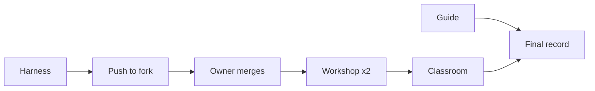

# Remove ui() and raw model ids in every repo, then add RunSetup setters

The work is in four repos, in three phases.

- Phase 1, `runvil-harness`: the plan, three code commits that each pass the full verification list, a record of what the build found, then a push to the fork.
- Phase 2, `runvil-docs`: the guide, in one commit. It needs nothing from Phase 1 but the decisions in this plan, so it can run beside it.
- Phase 3, `runvil-workshop`, then `runvil-classroom`: after you merge the Harness commits into `cppalliance/runvil-harness`. Workshop pins a commit of that repository, so it cannot build against the change before then.



## Where this plan lives

- The first Harness commit copies this plan to `runvil-harness/plan/2026-11-20-1-remove-ui-and-fluent-setters.plan.md`, alone. The repo's folder is `plan/`, and the name follows the files already in it.
- Two later commits record results in that copy, as the 2026-11-16 plan did: one before the Harness push, with what the build found and the todo statuses, and one after Phase 3.

## Tests in each commit

- Harness commit 1: one new runner test, one reworked runner test, six raw id tests removed.
- Harness commit 2: one new test, one kept under a new name, one rewritten, and the other tests that name `ui` adjusted.
- Harness commit 3: six behavior tests switched to the chain, one new chained test, and the example run.
- Workshop commit 1: the bindings test updated, and the agents server tests now run on the selected model through the default role.
- Not practical: the plan and record commits and the guide, which are text only, the classroom prompt, which has no test, and Workshop commit 2, which only removes code nothing reads.

# Phase 1: runvil-harness

- Commit 0: this plan, alone
- Commit 1: `models.get` takes the five roles only
- Commit 2: remove `ui()`, `RunParams::with_ui`, and `RunSetup::workspace_roots`
- Commit 3: one chainable setter per optional `RunSetup` field (six), used by the `run-prompt` example

Commit 1 comes before commit 2 because the snapshot is the switch that turns raw model ids on. The switch has to go before the snapshot does.

## Commit 1: `models.get` takes the five roles only

### Code

- [runvil-harness/crates/runvil-internal/lua/src/models.rs](runvil-harness/crates/runvil-internal/lua/src/models.rs): remove `RawModelIds`, `RAW_ID_CONTEXT`, `raw_gateway_binding`, and the `raw_ids` parameter of `install_models`. `get` becomes the role's binding, or `not_a_role("models.get", ..)`.
- [runvil-harness/crates/runvil-internal/lua/src/vm.rs](runvil-harness/crates/runvil-internal/lua/src/vm.rs) and [vm/inject.rs](runvil-harness/crates/runvil-internal/lua/src/vm/inject.rs): remove the `raw_model_ids` field and `allow_raw_model_ids`, and fix the `Uninjected` doc.
- [runvil-harness/crates/runvil-internal/lua/src/test_vm.rs](runvil-harness/crates/runvil-internal/lua/src/test_vm.rs): remove the `raw_model_ids` builder and the doc lines that name it.
- [runvil-harness/crates/runvil-internal/lua/src/compactors.rs](runvil-harness/crates/runvil-internal/lua/src/compactors.rs): reword the comment that cites a raw id's guessed window.
- [runvil-harness/crates/runvil-internal/runtime/src/execute/section_vm.rs](runvil-harness/crates/runvil-internal/runtime/src/execute/section_vm.rs): remove the opt-in call and the comments about it.
- [runvil-harness/crates/runvil-internal/runtime/src/execute/params.rs](runvil-harness/crates/runvil-internal/runtime/src/execute/params.rs): cut the raw id sentences from the `with_ui` doc, so the doc stays true for this one commit.

### Tests

- New, in [runvil-harness/crates/harness-internal/runner/tests/it/harness.rs](runvil-harness/crates/harness-internal/runner/tests/it/harness.rs): a Harness run refuses a Gateway model id. The prompt calls `pcall(models.get, 'vendor/raw-model')` and returns the outcome. The test asserts the call failed with the words `is not a model role`. Before this commit the same call returned a handle.
- Reworked, in [runvil-harness/crates/harness-internal/runner/tests/it/render-calls.rs](runvil-harness/crates/harness-internal/runner/tests/it/render-calls.rs): `two_models_get_their_own_renders_and_a_stop_spares_only_the_surviving_call` uses raw id `n` to get a second model. It becomes two runs on the one model. The render Pack's config already lists the models whose render survives a stop, so the first run passes `{ "surviving": [MODEL] }` (the stop spares the call, and the loop goes on) and the second passes an empty list (the stop drops the call, and the loop raises). Remove section `OnN`, the `n` assertions, and the comparison of renders across two models. Rename the test and fix the module doc and the constant's doc.
- Removed, because they test raw ids alone: `models_use_accepts_a_raw_id_handle_from_models_get`, `models_get_resolves_a_label_outside_the_roles_as_a_raw_gateway_id_only_when_permitted`, and `the_raw_id_fallback_still_validates_the_gateway_id` in `lua/src/models-tests.rs`; `a_raw_id_handle_runs_the_next_round_on_its_gateway_model` in `runtime/src/execute/tests/suite/prepare.rs`; `a_raw_gateway_model_id_renders_with_a_model_info_built_from_its_binding` in `runtime/src/execute/tests/render_effect.rs`, with the words about a raw model id in its module doc; `a_raw_id_handle_fans_out_with_no_model_supplied` in `runtime/src/execute/tests/scheduler/fanout_model.rs`.
- Kept as they are: `models_get_rejects_a_label_outside_the_five_roles` and the `models.get('ghost')` run in `exec_flow.rs` pin the refusal in the Engine, and `a_handle_round_renders_and_then_chats_on_the_handles_binding` pins that a round renders for its own handle's model.

### Page

In [runvil-harness/decisions/models-and-conversations.md](runvil-harness/decisions/models-and-conversations.md), the entry "`models.get` returns a role's handle and leaves the current model as it is" (line 63) becomes:

```markdown
`models.get('fast')` returns the handle of the `fast` role. A role name is a string that Lua passes as an argument. A name outside the five roles raises an error that lists them.

A prompt names a model by its role, and the Host chooses the model that fills each role ([The Harness and the Host API](harness-and-host.md)).
```

### Listing

No facade line changes. `xtask api --check` must pass with the listings as they are.

## Commit 2: remove `ui()`, `with_ui`, and `workspace_roots`

### Engine

- [runvil-harness/crates/runvil-internal/lua/src/engine_globals.rs](runvil-harness/crates/runvil-internal/lua/src/engine_globals.rs): remove `install_ui` and `UI_SNAPSHOT_OPTIONS`, and fix the module doc. Remove the re-exports in `lua/src/lib.rs` and `runtime/src/lua.rs`.
- [runvil-harness/crates/runvil-internal/lua/src/globals.rs](runvil-harness/crates/runvil-internal/lua/src/globals.rs): remove `("ui", Reserved::EngineGlobal)` and fix the `EngineGlobal` doc. The name `ui` is then free for a prompt or a Pack prelude.
- Doc comments that name `ui`: `lua/src/prelude.rs` (the collision check) and `lua/src/vm.rs` (`lua()`).
- [runvil-harness/crates/runvil-internal/runtime/src/execute/params.rs](runvil-harness/crates/runvil-internal/runtime/src/execute/params.rs): remove the `ui` field, `with_ui`, the `Debug` line, and the words in the doc of `new`.
- [runvil-harness/crates/runvil-internal/runtime/src/execute/context.rs](runvil-harness/crates/runvil-internal/runtime/src/execute/context.rs) and [section_vm.rs](runvil-harness/crates/runvil-internal/runtime/src/execute/section_vm.rs): remove the `ui` field from the run's shared state and from the section setup, the install call, and the doc lines.

### Harness

- [runvil-harness/crates/harness-internal/runner/src/setup.rs](runvil-harness/crates/harness-internal/runner/src/setup.rs): remove the `workspace_roots` field, its default, its `Debug` line, and the words in the doc of `new`.
- [runvil-harness/crates/harness-internal/runner/src/prepare.rs](runvil-harness/crates/harness-internal/runner/src/prepare.rs): remove the `.with_ui(..)` call and the `ui` helper.
- [runvil-harness/crates/runvil/src/lib.rs](runvil-harness/crates/runvil/src/lib.rs): cut "workspace roots" from the list of what a `RunSetup` holds (line 21).

`selected_model` stays. It picks the run's model, and a prompt reads that model through a role's handle, as in `models.get('default').model_id`.

### Tests

- New, in `lua/src/prelude-tests.rs`: a prelude that defines `ui` installs. Before this commit it failed as a reserved name. The collision test beside it, and its twin in `runtime/src/execute/tests/preludes.rs`, loop over `item` alone and lose `ui` from their names.
- Kept under a new name, in `runtime/src/execute/tests/run_inputs.rs`: `a_run_without_a_ui_snapshot_installs_no_ui_global` becomes `a_run_installs_no_ui_global`. The other test there, `the_ui_global_serves_the_snapshot_taken_at_run_start`, is removed, and the module doc loses `ui`.
- Rewritten, in `runner/tests/it/harness.rs`: `the_ui_snapshot_serves_the_selected_model_and_the_first_workspace_root` becomes a test that a prompt reads the selected model through a role's handle, with a prompt that returns `models.get('default').model_id`. No runner or facade test reads a handle's `model_id` today, so removing the old test outright would drop the one Harness test that a prompt can see the selection.
- Adjusted: `lua/src/prelude-tests-environment.rs` drops the `install_ui` call and the `type(ui)` probes, with the expected strings shortened to match. `runtime/src/lua/tests.rs` and `runtime/src/lua/tests/globals.rs` drop the `ui` field of `VmBinds` and its use in `fully_bound_vm`. The check there that the reserved list matches the installed globals, in both directions, then pins the removal.

### Pages

- [runvil-harness/decisions/prompt-language.md](runvil-harness/decisions/prompt-language.md), line 251: the functions become "`call`, `execute`, `jump`, `log`, `require`, and `untrusted`", and the next sentence becomes "One global exists only in some VMs: `item`, in the first section of a task whose spawn supplied one."
- Same page: remove the whole entry "`ui()` returns the Host's snapshot from the start of the run" (lines 281 to 283).
- [runvil-harness/decisions/harness-and-host.md](runvil-harness/decisions/harness-and-host.md), line 77: "empty values in `selected_model` and `workspace_roots`" becomes "no selection in `selected_model`".
- Same page, line 85: remove the last sentence, "A prompt reads `selected_model` and the first of `workspace_roots` through `ui()`."

### Listings

With `CARGO_BUILD_WARNINGS` unset, run `cargo +nightly-2026-09-05 xtask api --bless`. The diff must be exactly two removed lines:

- In `crates/runvil-engine/public-api.txt`: `pub fn runvil_engine::RunParams::with_ui(..)`
- In `crates/runvil/public-api.txt`: `pub runvil::RunSetup::workspace_roots: ..`

Anything else in that diff means stop and look.

## Commit 3: one setter per optional field, used by the example

### Code

In [runvil-harness/crates/harness-internal/runner/src/setup.rs](runvil-harness/crates/harness-internal/runner/src/setup.rs), add six methods to the existing `impl RunSetup` block, after `new`. Same shape as the `ToolInfo` setters: by value, `#[must_use]`, named after the field.

```rust
/// Sets the filesystem the run's tool calls work in.
#[must_use]
pub fn vfs(mut self, vfs: VfsRef) -> RunSetup {
    self.vfs = vfs;
    self
}

/// Sets the model id the user selected.
#[must_use]
pub fn selected_model(mut self, model: impl Into<String>) -> RunSetup {
    self.selected_model = Some(model.into());
    self
}

/// Sets the run's arguments: the text of one JSON object.
#[must_use]
pub fn args(mut self, args: impl Into<String>) -> RunSetup { .. }

/// Sets the run's resource limits.
#[must_use]
pub fn limits(mut self, limits: RunLimits) -> RunSetup { .. }

/// Sets the most tool calls in flight at once.
#[must_use]
pub fn max_tool_calls_in_flight(mut self, max: NonZeroUsize) -> RunSetup { .. }

/// Sets whether a user answers the main chain's inbox (`true`), so the
/// run holds `runvil/user`, or the run has no user (`false`).
#[must_use]
pub fn has_user(mut self, has_user: bool) -> RunSetup { .. }
```

- No setter for `recorder` or `broker`. They stay the required arguments of `new`.
- The fields stay public, so struct update syntax keeps working.
- Add one sentence to the doc of `new`: each of those fields has a method of its name that sets it.

### Tests

Switch one existing behavior test per setter from struct update to the chain. Each one already fails if its field is not set. All are in `runvil-harness/crates/harness-internal/runner/tests/it/`:

- `args`: `with_args` in `prepare-args.rs` becomes `setup_over(recorder).args(args)`
- `has_user`: `with_user` in `prepare-user.rs` becomes `setup_over(recorder).has_user(true)`
- `vfs`: the setup of the tool context test in `tool_context.rs` becomes `setup_over(..).vfs(vfs.clone())`
- `selected_model`: the absent selection test in `harness-errors.rs` becomes `setup(..).selected_model("absent")`
- `limits`: `the_setups_limits_reach_the_run` in `prepare.rs` becomes `RunSetup::new(..).limits(limits)`
- `max_tool_calls_in_flight`: `Rig::drive` in `effect_loop-cap.rs` becomes `RunSetup::new(..).max_tool_calls_in_flight(self.cap)`

Add one new test in `prepare.rs`: a setup built with all six setters in one chain holds all six values. Each switched test uses one setter, so chaining several is otherwise untested.

The other 18 struct update sites stay as they are, so both forms stay exercised. If a switch leaves an import unused, remove the import.

### Example

In [runvil-harness/crates/runvil/examples/run-prompt.rs](runvil-harness/crates/runvil/examples/run-prompt.rs), `Offline`, `Clock`, the imports, and the file's header comment stay. `main` becomes:

```rust
#[tokio::main(flavor = "current_thread")]
async fn main() -> Result<(), Box<dyn std::error::Error>> {
    // 1. Build the Host once: its installed Packs, how it finds prompts,
    //    and its timer. A stock finder serves the one prompt under its
    //    name and finds no other.
    let host = Arc::new(Host {
        packs: Packs::new(PackRegistry::new()),
        prompts: Arc::new(FindTextPrompt::new(GREET_NAME, GREET)),
        timer: Arc::new(Clock),
    });

    // 2. Find the prompt by its name and parse it.
    let prompt = host.parse(GREET_NAME)?;

    // 3. Give this run its recorder, its broker, and the operator's name;
    //    every other field keeps its default, such as an empty memory
    //    filesystem for the run's tool calls.
    let setup = RunSetup::new(Arc::new(MemoryRecorder::new()), Arc::new(Offline))
        .args(r#"{"text":"desk"}"#);

    // 4. Run it to its end; the Harness is spent. The first `?` is a
    //    recorder's refusal, and the second is how the run ended. A Host
    //    that wants the run's id or its unread messages keeps the report.
    let greeting = Harness::new(host, prompt, setup).run().await?.result?;
    assert_eq!(greeting, "Hello, desk.");
    println!("{greeting}");
    Ok(())
}
```

The example no longer compares the recorder's result with the report's. The facade suite already asserts that in `runvil-harness/crates/runvil/tests/suite/host.rs`. Run `cargo run -p runvil --example run-prompt`, which must print `Hello, desk.`.

### Page

In [runvil-harness/decisions/harness-and-host.md](runvil-harness/decisions/harness-and-host.md), add a new entry right after the `RunSetup::new` entry. No existing heading or sentence changes in this commit.

```markdown
### Each optional field of `RunSetup` has a method that sets it and returns the setup

Each field that `RunSetup::new` starts at a default has a method of the same name, which takes the setup, sets the field, and returns the setup. A Host writes a setup as one expression, as in `RunSetup::new(recorder, broker).args(text).has_user(true)`. The method `selected_model` takes the model id itself. The fields are public too, so a Host that holds a setup assigns a field directly.

The methods let a Host name only the fields it changes. The recorder and the broker are set by `RunSetup::new` alone, because they are its required arguments.
```

### Listing

Bless again. The diff of `crates/runvil/public-api.txt` must be exactly six added lines, each starting `pub fn runvil::RunSetup::`.

## Verification, before each of commits 1 to 3

Run from `runvil-harness`, in this order, and fix what fails before committing:

- `cargo fmt --all --check`
- `$env:CARGO_BUILD_WARNINGS = "deny"; cargo clippy --workspace --all-targets --all-features`
- `cargo nextest run --locked --workspace --all-features`
- `$env:RUSTDOCFLAGS = "-D warnings"; cargo doc --workspace --no-deps --all-features; cargo doc -p runvil-engine --no-deps`
- `Remove-Item Env:CARGO_BUILD_WARNINGS, Env:RUSTDOCFLAGS; cargo +nightly-2026-09-05 xtask api --check`
- `cargo dylint --all -- --locked --workspace --all-targets --all-features`
- `cargo test -p build-xtask`
- `node --test tools/docs-claims.mjs`

Each commit goes on `master`, with its message written from the staged diff by the workspace commit rule.

## Record, push, then the merge

- Add a section to the repo's copy of the plan that says what the build found, set the statuses of the finished todos, and commit it alone.
- Run `git push origin master` in `runvil-harness`. Origin is your fork. The pre-push hook runs the wording check, clippy, and `cargo deny`.
- You merge the fork's `master` into `cppalliance/runvil-harness`, as with the plugin-api work of 2026-11-16. I open no pull request.

# Phase 2: the guide (`runvil-docs`), one commit

The chapters are hand-edited, and the repo has no automated check. Its house rules are a single dash only, four-backtick fences, and one paragraph per line. All files are in `runvil-docs/src/language/`. The line numbers below are from today and shift as edits land, so the headings are the anchor.

Raw model ids:

- [10-models.md](runvil-docs/src/language/10-models.md): remove the section "Raw model ids and the Host-state snapshot" (lines 1058 to 1104). Fix the exception clauses (45, 64), the handle notes (682, 938), the opening of "Getting handles with `models.get`" and its example note (980, 1048), "`models.get` errors and check order" (1107, 1112), and the two notes that a raw id handle runs with no model (1152, 1272).
- [02-file-structure.md](runvil-docs/src/language/02-file-structure.md): lines 653 and 738.
- [11-conversations.md](runvil-docs/src/language/11-conversations.md): line 1962.
- [01-what-a-prompt-is.md](runvil-docs/src/language/01-what-a-prompt-is.md): line 565.
- [17-quick-reference.md](runvil-docs/src/language/17-quick-reference.md): the handle rows (65, 66, 69) and the `models.get` row (124).

`ui()`:

- [05-lua-environment.md](runvil-docs/src/language/05-lua-environment.md): remove the section "The Host's state in `ui()`" (lines 2406 to 2435). Rename "Run facts in `sys` and `ui`" to "Run facts in `sys`" and fix its opening (2135, 2137). Fix the chapter opening (3), the Engine globals text and list (168, 183, 194), and the two prelude notes (285, 322).
- [12-tools.md](runvil-docs/src/language/12-tools.md): the helper example and its expected output (2786), the reserved list (2867), and the prelude note (2874).
- `01-what-a-prompt-is.md`: lines 465 to 470.
- `17-quick-reference.md`: remove the `ui` row (233).
- Every link to `#run-facts-in-sys-and-ui` becomes `#run-facts-in-sys`, with its link text. There are about 20, in chapters 01, 04, 05, 07, 10, 12, 14, 15, and 17.

The commit is done when this search of `src/language` comes back empty:

`rg -n "\bui\b|[Rr]aw (gateway )?model id|\braw[- ]id\b|Host-state|UI snapshot|application-state snapshot|run-facts-in-sys-and-ui"`

Then run `git push origin master`. Origin is your fork.

# Phase 3: Workshop, then the classroom, after the merge

Workshop pins the Harness at `f75aadb2`, which is today's Harness `master`, so the new pin brings in these changes and nothing else. I start when `gh api repos/cppalliance/runvil-harness/commits/master` shows a commit that holds the three code commits, and I pin that commit.

## Workshop commit 1: take the merged Harness and adapt

- [runvil-workshop/Cargo.toml](runvil-workshop/Cargo.toml) (lines 28 to 30): the three `rev` values become the merged commit. Run `cargo fetch` to refresh `Cargo.lock`.
- [runvil-workshop/crates/workshop/server/src/agents/bindings.rs](runvil-workshop/crates/workshop/server/src/agents/bindings.rs): `with_host_state` sets the selected model only. Fix the module doc and the function doc.
- `bindings-tests.rs` beside it: drop the roots half and rename the test.
- [runvil-workshop/crates/workshop/server/tests/it/agents.rs](runvil-workshop/crates/workshop/server/tests/it/agents.rs): the fixture's Gateway lists `model-a` first and the fixture selects nothing, so today the test prompts reach `test-model` only by raw id. Select `test-model` in the menu inside `spawn_agent_server_for_gateway`, as `bindings-tests.rs` does with `menu.set_selected`. Then `models.loop(models.get('test-model'))` becomes `models.loop()` in the echo prompt there and in the steer prompt in `agents/turns.rs`.
- `server/tests/it/agents/revoke.rs`: remove the file and its `mod revoke;` line in `agents.rs`. Its subject, a run that reads a workspace root, no longer exists. By the workspace rule the file moves to `cabinet/_trash/`. Every helper it calls has other callers, so none is left unused.
- `server/tests/it/chat_gate.rs` (line 104): reword the comment that names the `ui()` snapshot.

Tests: the bindings test now asserts the selection alone, and every agents server test that sends a turn pins that a run on a selected model reaches it through the default role.

## Workshop commit 2: remove the registry slot that nothing reads

After commit 1 no production code reads `dyn WorkspaceRoots`, and its change signal has no subscriber. All paths are under `runvil-workshop/crates/workshop/`.

- `registry/src/traits.rs` and `registry/src/lib.rs`: remove `WorkspaceRoots`, `WorkspaceRootsAdapter`, the re-export, and the two doc mentions. Remove the two tests of the slot in `registry/tests/it/main.rs`.
- `workspace/src/handles.rs`: remove the `roots` registration and its field in `WorkspaceRegistrations`.
- `workspace/src/workspace.rs` and `workspace/src/workspace/backing.rs`: remove `subscribe_roots`, `bump_roots` with its four call sites, and the `roots_generation` field. Remove the signal test in `workspace/src/workspace/tests/grants.rs` and the roots assertions in `workspace/tests/it/main.rs`.
- `server/src/app/compose.rs`: remove `require::<dyn WorkspaceRoots>()` and `registrations.hold(regs.roots)`. Remove the invariant line about the slot in `server/src/lib.rs`.

Tests: none added, since the commit only removes code nothing reads. The registration test in `workspace/tests/it/main.rs` keeps asserting what `register` puts in the registry.

## Workshop verification, before each commit

The list in Workshop's `AGENTS.md`: `cargo fmt --all --check`, clippy in its two groups with `CARGO_BUILD_WARNINGS=deny`, nextest in its two groups, `cargo doc` with `RUSTDOCFLAGS="-D warnings"`, `cargo dylint`, `cargo test -p build-xtask`, and `node --test crates/workshop/ui/test/docs-claims.mjs`.

Then run `git push origin master`. Origin is your fork.

## The classroom (`runvil-classroom`), one commit, last

In [runvil-classroom/students/parsons/prompts/briefer.md](runvil-classroom/students/parsons/prompts/briefer.md), `discover_operator` reads the operator's name from `ui().workspace_root` behind a guard. Remove the function (lines 824 to 833) and make its one call, line 28, `var.operator = ""`.

It goes last because today's Workshop still serves `ui()`, so the function still finds a name there. The guard keeps the prompt running on both the old and the new Harness, so nothing breaks while it waits.

The repo's `AGENTS.md` says to commit on `master` and push to `master` of `cppalliance/runvil-classroom`, so this one is pushed straight there.

## Final record

Add the results of the guide, Workshop, and classroom work to the repo's copy of the plan, commit it alone in `runvil-harness`, and push to origin.

# What each step needs

- Harness commit 0 needs this plan's text and the file name above.
- Harness commit 1 needs nothing from an earlier step.
- Harness commit 2 needs commit 1: with the raw id switch gone, the snapshot's only job is the `ui()` global.
- Harness commit 3 needs commit 2: it leaves six optional fields.
- The record and the push need the results of commits 1 to 3.
- The guide needs only the decisions in this plan.
- Workshop commit 1 needs the merged commit's id, which it reads from `cppalliance/runvil-harness` `master`.
- Workshop commit 2 needs Workshop commit 1: until then the slot has a reader.
- The classroom needs nothing. It is last by choice.
- The final record needs the results of Phases 2 and 3.

# Choices I settled

- Raw ids and `ui()` go in two commits, not one (confidence: medium - one is a change to what `models.get` accepts, the other removes a global and a field, and each reads better alone).
- `ui()` and `workspace_roots` go in the same commit, Engine and Harness together (confidence: medium - a split by crate would leave the page's `ui()` entry false for one commit).
- The example goes in the setters commit (confidence: medium - it gives every code commit a test, and the stock finders plan changed the example in the same commit as its API).
- The guide is one commit (confidence: medium - several paragraphs name both features, so two commits would edit them twice).
- The two-model render test becomes two one-model runs (confidence: high - the render Pack already takes the list of models whose render survives a stop).
- Setters for the six optional fields only, none for `recorder` or `broker` (confidence: high - a setter would be a second way to supply a required argument).
- `selected_model` takes `impl Into<String>` and sets `Some`, as `ToolInfo::wire_name` does (confidence: high - same precedent, same lints).
- Pushes go to your forks for the Harness, the guide, and Workshop, and straight to `cppalliance` for the classroom (confidence: high - the first follows the 2026-11-16 plan, the second is the classroom's written rule).
- Workshop's `revoke.rs` test is removed, not rewritten (confidence: medium - a run can no longer observe a root, the workspace crate tests grant and revoke itself, and `gate_selection_loss_leaves_the_runs_frozen_binding_untouched` covers a run keeping its launch state, but I did not check whether a run's file access after a revoke is tested anywhere).
- The `WorkspaceRoots` slot goes in its own Workshop commit (confidence: medium - a slot with no reader is dead code, but you may have a use planned, and dropping that one commit costs nothing).
- The classroom function is removed instead of left with a dead branch (confidence: medium - it is a student's prompt).

# Not in this plan

- No pull request is opened in any repo.
- `runvil-design` is retired, so its copies of the decision pages keep their old text. So do the history files under `vibe/` and `plan/` in every repo.
- Steps 3 to 5 of the fluent walk (stock offline broker, `Host::new`, launch by name) are untouched.
- `ModelBinding::render_info()` keeps its fallback for a binding with no catalog info. Raw ids were its main user, and I did not trace whether another one remains.

# Risks

- Harness commits 1 and 2 touch about 25 files across the Engine. I listed every site a search found, but the compiler and clippy have the last word, mostly on imports left unused.
- I cannot see the custom dylint rules from here, so that check is the one most likely to ask for a small change in the setters.
- The Workshop fixture change is the step I am least sure of. I read the fixture but did not run it, and a test that needs no selection would need its own handling.
- The new runner test in commit 1 asserts on the words `is not a model role`. The Engine's own test uses them, but I did not read how the error reaches a prompt's `pcall`.
- PR 27 is still open and edits `setup.rs` and the example, so it will conflict with these commits. That is expected, since this is the do-over.
- If the merge rewrites the Harness commits, their ids change. I pin whatever commit `cppalliance/runvil-harness` `master` ends up holding.
- The guide is about 60 hand edits in 11 chapters with no automated check. The closing search is the only gate, and one example's new expected output (chapter 12, line 2786) is worked out by hand, not run.
- The guide's renamed heading changes one anchor, and two removed sections drop two more. I searched every repo here, the site shell in `runvil` included, and nothing outside the guide links to any of the three.
