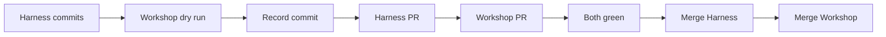

# Export a stock offline broker and use it in every repo (step 3 of the fluent walk)

One new public type, `runvil::harness::OfflineBroker`, replaces six hand-written copies: four in `runvil-harness` and two in `runvil-workshop`. A Host still passes it to `RunSetup::new`, so a Host that leaves the broker out still fails to compile. The classroom stays as it is.

## Where this starts

- `runvil-harness` `master` is `d8a9414e`, clean, and equal to the fork and to `cppalliance` (checked with `git` and `gh` at 14:45 PST). The whole workspace ran 3,973 tests at `c973b8a2`, all passing, 25 skipped.
- `runvil-workshop` `master` is `41c2aa6b`, clean, and equal to the fork and to `cppalliance`. It pins the Harness at `fb29b8a2`. Its two test groups ran 706 and 353 tests, all passing.
- A search of every checkout in the workspace found copies of this broker in three repos only: the Harness (four), Workshop (two), and the classroom (two, left alone). The guide, the Gateway, the plugin repos, and the site shell hold no `InferenceBroker` at all.
- Open pull requests on the Harness: #56, #27, #26, #14. If #56 merges first, upstream `master` moves (see Publishing).

## The order of work



- Harness commit 0: this plan alone, copied to `runvil-harness/plan/2026-11-20-2-stock-offline-broker.plan.md`.
- Harness commit 1: add `OfflineBroker`, its tests, its page entry, and its listing lines.
- Harness commit 2: use it at the four sites, and rewrite the testing page entry.
- Workshop dry run: the switch, built against the local Harness through a temporary `[patch]`.
- Harness commit 3: the record of what the build found in both repos.
- Harness: push to the fork, open the pull request.
- Workshop commit: pin the Harness head and use the stock broker. Push to the fork, open the pull request.
- Both pull requests green: merge the Harness, then Workshop.

Every commit goes on `master`. Each code commit passes its repo's whole verification list by itself.

## Harness commit 1: add `OfflineBroker`

### The new type

New file [runvil-harness/crates/harness-internal/runner/src/performers_offline.rs](runvil-harness/crates/harness-internal/runner/src/performers_offline.rs), a peer of `performers.rs` the way `recorder_memory.rs` is a peer of `recorder.rs`:

```rust
//! The stock offline broker: an empty model list, and every round
//! refused.

/// The broker of a Host that runs prompts without a model.
///
/// It lists an empty catalog. A run over it whose setup selects no model
/// therefore binds none: a prompt that asks no model runs to its end, and
/// a `models.infer` or `models.loop` fails as
/// [`ModelRequired`](ErrorCode::ModelRequired) before a round reaches the
/// broker. A run whose setup selects a model ends as
/// [`RequirementsUnmet`](ErrorCode::RequirementsUnmet), because the list
/// lacks the selection.
///
/// A round that reaches it all the same, from a broker that hands its
/// rounds on or from code outside the Harness, fails as
/// [`Unavailable`](ErrorCode::Unavailable) with that code's fixed phrase.
///
/// Both futures are ready at the first poll, on any executor.
#[derive(Debug)]
pub struct OfflineBroker;

impl InferenceBroker for OfflineBroker {
    fn models(&self) -> BoxFuture<'static, Result<ModelCatalog, Error>> {
        Box::pin(async { Ok(ModelCatalog::empty()) })
    }

    fn chat(&self, _binding: ModelBinding, _messages: Vec<Message>, _tools: Vec<ToolSchema>,
        _options: CompletionOptions, _round: Round,
    ) -> BoxFuture<'static, Result<Box<Completion>, Error>> {
        let code = ErrorCode::Unavailable;
        Box::pin(async move { Err(make_completion_error(code, phrase(code))) })
    }
}
```

The body is the copy that the example holds today, unchanged.

### Wiring

- [runvil-harness/crates/harness-internal/runner/src/lib.rs](runvil-harness/crates/harness-internal/runner/src/lib.rs): add `mod performers_offline;` after `pub mod performers;`, and one sentence to the crate doc after the stock finders sentence. That doc has `## Invariants`, so the wording check reads it.
- [runvil-harness/crates/harness-internal/runner/src/performers.rs](runvil-harness/crates/harness-internal/runner/src/performers.rs): add `pub use crate::performers_offline::OfflineBroker;`, and one sentence to the module doc after "The Host supplies the `InferenceBroker` and the `Timer`."
- [runvil-harness/crates/runvil/src/lib.rs](runvil-harness/crates/runvil/src/lib.rs): add `pub use harness_runner::performers::OfflineBroker;` between the `InferenceBroker` and `Timer` lines of `pub mod harness`, and name the stock broker in that module's doc.

### Tests

- Two unit tests at the bottom of `performers_offline.rs`, each polling its future once with `now_or_never`, as `packs-tests.rs` does. One asserts that `models()` is ready with an empty catalog. The other asserts that `chat` is ready with the code `Unavailable` and that code's phrase as its prose. Polling once also pins that the futures are ready at the first poll.
- One runner test in [runvil-harness/crates/harness-internal/runner/tests/it/harness-errors.rs](runvil-harness/crates/harness-internal/runner/tests/it/harness-errors.rs), with one clause added to the module doc. It reuses the file's `CATCHES_A_ROUND` prompt and `harness_with`:

```rust
#[tokio::test]
async fn a_run_over_the_offline_broker_binds_no_model_and_fails_a_round_where_the_prompt_asks() {
    let recorder = Arc::new(MemoryRecorder::new());
    let setup = RunSetup::new(recorder.clone(), Arc::new(OfflineBroker));
    let report = harness_with(CATCHES_A_ROUND, setup).run().await.expect("the run is reported");
    assert_eq!(report.result, Ok("false:model_required".to_owned()));
    let records = recorder.records(report.run_id);
    assert!(answers_to(&records, "Chat").is_empty(), "no round reaches the broker");
}
```

- Expected count: 3,976 tests, which is 3,973 plus these three.

### Page

In [runvil-harness/decisions/harness-and-host.md](runvil-harness/decisions/harness-and-host.md), three edits.

Section 1, entry "A Host depends on one crate, `runvil`": "and the stock prompt finders" becomes "the stock prompt finders, and the stock offline broker".

Section 2, entry "`RunSetup::new` takes the recorder and the broker, and every other field has a default": the last paragraph becomes:

```markdown
The broker is a required argument because the Harness asks the broker of every run for its models before it prepares the run. A Host that leaves it out fails to compile. A Host that runs prompts without a model passes `OfflineBroker` (see Inference, the clock, and what a Host hands its Plugins), so the code that builds the setup says so. A broker that a Host could leave out would be missed only when a prompt first asks for a model.
```

Section 4, a new entry right after "The Harness picks the run's model once, and that model fills every role":

```markdown
### `OfflineBroker` is the stock broker of a Host that runs prompts without a model

`runvil::harness` has a stock broker, `OfflineBroker`. Its `models()` lists an empty catalog, and its `chat` fails every round with the code `Unavailable`. A run over it that selects no model picks none, and the Harness passes the Engine an empty role map. A prompt that asks no model runs to its end. A `models.infer` or a `models.loop` raises an error of kind `model_required` before a round reaches the broker ([Model calls and conversations](models-and-conversations.md)). A run that selects a model ends with `RequirementsUnmet`, because the list lacks the selection.

The Harness exports the broker because Hosts run prompts without a model: a tool that runs a prompt whose Lua does all the work, and a Host whose Gateway is not configured yet. Each would otherwise write the same broker and import the chat vocabulary of a round to do it. The Host still passes the broker to `RunSetup::new`, so a run without a model is a choice that the Host's code states.
```

The testing page stays as it is in this commit. Its entry says that Harness tests write their own brokers, which is still true until commit 2.

### Listing

Bless with `cargo +nightly-2026-09-05 xtask api --bless` while `CARGO_BUILD_WARNINGS` is unset. The diff of `crates/runvil/public-api.txt` must be exactly these four added lines, and `crates/runvil-engine/public-api.txt` must be unchanged. Any other line means stop and look.

```text
auto runvil::harness::OfflineBroker: Freeze, RefUnwindSafe, Send, Sync, Unpin, UnwindSafe
derives runvil::harness::OfflineBroker: Debug
impl runvil::harness::InferenceBroker for runvil::harness::OfflineBroker
pub struct runvil::harness::OfflineBroker;
```

Then `cargo fmt --all` and `verify.ps1 -Tag s3a`.

## Harness commit 2: use it at the four sites

- [runvil-harness/crates/runvil/examples/run-prompt.rs](runvil-harness/crates/runvil/examples/run-prompt.rs): remove `Offline` and its impl. The setup uses `Arc::new(OfflineBroker)`. The header comment and the comment of step 3 say "the stock offline broker". `Clock` stays. The imports shrink to:

```rust
use runvil::harness::{FindTextPrompt, MemoryRecorder, OfflineBroker, Packs, Timer};
use runvil::plugin::PackRegistry;
use runvil::{BoxFuture, Harness, Host, RunSetup};
```

- [runvil-harness/crates/runvil/tests/suite/support.rs](runvil-harness/crates/runvil/tests/suite/support.rs): remove `Offline`, the imports only it used, and the words "an offline broker" from the module doc. In `vfs.rs`, `launch.rs`, and `host.rs` beside it, `Offline` leaves the `crate::support` import, `OfflineBroker` joins the `runvil::harness` import, and the five `Arc::new(Offline)` become `Arc::new(OfflineBroker)`.
- [runvil-harness/crates/harness-internal/test-plugin/tests/it/run.rs](runvil-harness/crates/harness-internal/test-plugin/tests/it/run.rs): remove `Offline`, the `runvil::effect::Round` import, the whole `runvil::model` import, and `InferenceBroker`. One `Arc::new(Offline)` switches.
- [runvil-harness/crates/harness-internal/runner/src/environment-tests.rs](runvil-harness/crates/harness-internal/runner/src/environment-tests.rs): remove `EmptyBroker`, the fourth copy. Its two tests take `&OfflineBroker`, and `UnlistedBroker::chat` hands its round to `OfflineBroker`.

The two `Unused` brokers and the scripted brokers stay. If a switch leaves an import unused, remove the import.

### Page

In [runvil-harness/decisions/testing-and-debugging.md](runvil-harness/decisions/testing-and-debugging.md), the entry "Harness tests write their own brokers, and the Harness exports `MemoryRecorder`" becomes:

```markdown
### Harness tests write their own scripted brokers, and the Harness exports `OfflineBroker` and `MemoryRecorder`

A Harness test that needs a model's replies supplies them through an `InferenceBroker` that the test code defines. A test whose prompt asks no model uses `OfflineBroker`, the stock broker of a Host that runs prompts without a model ([The Harness and the Host API](harness-and-host.md)). `MemoryRecorder` is public and stores each run's records in a vector. `harness-runner` keeps the function that drives the effect loop public, so that tests have one entry point to the effect loop.

A public scripted broker would be test API that only the Harness's own tests use, so the Harness leaves it out. `OfflineBroker` is public because Hosts use it, and the tests use it because it is there.
```

### Checks

- Tests: none added. The existing tests of the facade suite, the test Plugin, and the model lookup now run over the stock broker. The count stays 3,976.
- Listing: unchanged, so `xtask api --check` passes as it is.
- `verify.ps1 -Tag s3b`, then `cargo run -p runvil --example run-prompt`, which must print `Hello, desk.`.

## Workshop: one commit that pins the Harness and uses the stock broker

### The switch

- [runvil-workshop/crates/workshop/server/src/agents/tests.rs](runvil-workshop/crates/workshop/server/src/agents/tests.rs): remove `OfflineBroker` and its impl. `OfflineBroker` joins the `runvil::harness` import, and the imports only the copy used go (`Round`, `InferenceBroker`, `BoxFuture`, and the whole `runvil::model` import, as far as the compiler agrees). The one `Arc::new(OfflineBroker)` reads the same as before.
- [runvil-workshop/crates/workshop/server/src/agents/bindings-tests.rs](runvil-workshop/crates/workshop/server/src/agents/bindings-tests.rs): `use crate::agents::tests::OfflineBroker;` goes, and the `runvil::harness` import becomes `{MemoryRecorder, OfflineBroker}`.
- [runvil-workshop/crates/workshop/agents/tests/it/support.rs](runvil-workshop/crates/workshop/agents/tests/it/support.rs): remove `Offline`, its imports, and the words "an offline broker" from the module doc. The setup uses `Arc::new(OfflineBroker)`.
- `WorkshopBroker` and `RunBroker` stay as they are. They are Workshop's own inference.

### The pin

- [runvil-workshop/Cargo.toml](runvil-workshop/Cargo.toml), lines 28 to 30: the three `rev` values become the Harness head, which is Harness commit 3. Then `cargo fetch`. `Cargo.lock` must change its source lines for `runvil-harness` and nothing else.
- The new pin brings in five Harness commits: the first walk's last record, and the four of this plan. All of them add, and none removes.

### Dry run, before the Harness is pushed

- Add the temporary `[patch."https://github.com/cppalliance/runvil-harness"]` section of the first walk to Workshop's root `Cargo.toml`, with path entries for `runvil`, `harness-gateway-client`, and `plugin-mcp`. It never goes into a commit.
- Make the three edits of the switch.
- Run clippy with warnings denied and nextest for the two crates that change: `-p workshop-agents -p workshop-server`, without `--locked`, because the patch changes the lock file.
- Restore `Cargo.toml` and `Cargo.lock` with `git restore`. The three test edits stay in the working tree for the real commit.

### The real commit, after the Harness pull request is open

- Set the pin, run `cargo fetch`, then `verify-workshop.ps1 -Tag s3w`, the whole list of Workshop's `AGENTS.md`. Expected counts: 706 and 353 tests, the same as before, since no test is added or removed.
- Commit, `git push origin master`, and open the pull request.

## Verification and commit messages

- Harness: `cabinet/_scratch/remove-ui-build/verify.ps1 -Tag <tag>` runs fmt check, clippy with warnings denied, nextest, both doc builds, `xtask api --check`, dylint, the `build-xtask` tests, and the wording check. Every line must read `exit=0`.
- Workshop: `verify-workshop.ps1 -Tag <tag>` beside it runs fmt check, clippy and nextest in their two groups, the doc build, dylint, the `build-xtask` tests, and the wording check.
- Each commit message is written from the staged diff by `.cursor/rules/commit.mdc`, saved in the scratch folder, and checked with `check-message.ps1 -Message <file> -Repo <path>`.

## Record

Harness commit 3 adds a section "What the build found" to the repo copy of the plan and sets the todo statuses. It covers the two Harness code commits and the Workshop dry run. The approved Cursor plan file stays as it is. The pull request numbers, the CI results, and the merges come after this commit, so I report them in chat.

## Publishing, in order

1. Harness: `git push origin master`. The pre-push hook runs the wording check, clippy, and `cargo deny`. Then `gh pr create --repo cppalliance/runvil-harness --base master --head vinniefalco:master`.
2. Workshop: the real commit above, pinned to the Harness head, then `git push origin master` and `gh pr create --repo cppalliance/runvil-workshop --base master --head vinniefalco:master`. Its body names the Harness pull request and says that it merges second.
3. Wait: `gh pr checks <number> --repo <repo> --watch` on both, until `ci-green` passes on both.
4. Merge the Harness: `git fetch upstream`, confirm that `upstream/master` is still `d8a9414e`, then `git push upstream master`. Confirm with `gh api repos/cppalliance/runvil-harness/commits/master --jq '.sha'`.
5. Merge Workshop: `git fetch upstream`, confirm that `upstream/master` is still `41c2aa6b`, then `git push upstream master`. Confirm the same way.

Why Workshop can pin before the Harness merges: the push to upstream is a fast-forward, so the Harness commits keep their ids, and GitHub serves a commit that an open pull request of `cppalliance/runvil-harness` holds. The `cargo fetch` in step 2 is the proof. At the moment Workshop merges, its pin names a commit that upstream `master` holds.

When to stop or change course:

- `cargo fetch` cannot get the Harness head before the merge. Then the Harness goes through steps 3 and 4 alone, and Workshop follows with its commit, pull request, and merge. I tell you when this happens.
- A check fails on a pull request. I fix it with a new commit on the fork, with no rewrite. If the Harness head changes that way, Workshop moves its pin to the new head.
- Upstream `master` moved in either repo. I stop and tell you, because a rebase rewrites commits that the fork already holds.

## What each step needs

- Harness commit 0 needs this plan's text and the file name above.
- Harness commit 1 needs nothing from commit 0. Inside it, the type and its wiring come first, the tests and the page are independent of each other after that, the bless needs all code edits, and the verification needs the bless.
- Harness commit 2 needs the type of commit 1. Its four site switches are independent of each other.
- The Workshop dry run needs the type of commit 1 in the local Harness checkout. It needs nothing from commit 2.
- Harness commit 3 needs the results of commits 1 and 2 and of the dry run.
- The Harness pull request needs commit 3.
- The Workshop commit needs the id of Harness commit 3, an open Harness pull request so that the id can be fetched, and the three test edits that the dry run left in the working tree.
- The merges need `ci-green` on both pull requests and two upstream branches that have not moved. Workshop's merge needs the Harness merge.

Nothing here gains from running in parallel on one machine: the Harness verification and the Workshop dry run are both full builds.

## Choices I settled

- Two Harness code commits, add and then use (confidence medium: each passes the whole list by itself, the first is new surface with its own tests, the second removes copies that existing tests cover, and each page is true in its own commit).
- One Workshop commit for the pin and the switch (confidence medium: the pin moves only to get the type).
- Workshop pins the Harness head while the Harness pull request is still open (confidence medium: it makes both pull requests green before either merge, which is how I read "once everything is green", and it has a fallback if the fetch fails).
- The dry run checks the two crates that change, and the whole Workshop list runs once, on the real pin (confidence medium: the dry run only has to show that the switch compiles and passes before anything is pushed).
- One record commit, before publishing (confidence medium: a second record after the merges would need its own push and CI round).
- The file is `performers_offline.rs`, re-exported through `performers` only (confidence medium: it follows `recorder_memory.rs`, and the broker trait is reached the same way).
- The type is a unit struct that derives `Debug` alone, written `Arc::new(OfflineBroker)` (confidence medium: the workspace lint needs `Debug`, and nothing needs `Clone`, `Copy`, or `Default`).
- `EmptyBroker` in `environment-tests.rs` switches too (confidence medium: it is the same broker, and you chose all sites).
- One new runner test of a run with an empty role map (confidence medium: a search of the Harness crates found no test of `model_required`, and the new page entry states that behavior).
- The plan commit and the record commit skip the full verification list (confidence medium: they change only files under `plan/`, which no check reads, and the first walk did the same).

## Not in this plan

- Steps 4 and 5 (`Host::new`, launch by name), and `Clock`, which the example still writes by hand.
- The two student Hosts in `runvil-classroom` that hold a copy (Kirill's and Robles's), and the pull of the classroom's newer upstream commit.
- Turning `WorkshopBroker` into a plain shared struct, so that `RunBroker` is Workshop's one broker.
- The loose ends of the first walk: the two-model test broker, issue #29, PR #27, and the stale "Left open" bullets.

## Risks

- I read the `model_required` path in the Engine and on the models page, but no run checked the string `false:model_required`. If the kind differs, the test takes the kind the run reports, and the record says so.
- The four listing lines are a prediction from how `AllowAll` and `MemoryRecorder` are listed.
- I cannot see the custom dylint rules from here, so that check is the one most likely to ask for a small change.
- Fetching a commit that only an open pull request holds is how I expect `cargo` and GitHub to behave, but I have not tried it in these repos. The fallback above covers it.
- If PR #56 merges into the Harness while this work is open, upstream `master` moves and I stop.
- PR #27 edits the example, so its conflict with `master` grows. That is expected.

# What the build found

The plan held in both repos. This record was written after the two Harness code commits and the Workshop dry run, and before anything was pushed. These points differ from the plan above, or add to it.

## Harness commit 0, `9c91ace9`: the plan

- **The copy is one status ahead of the approved plan.** Cursor's todo list wrote `in_progress` for the first todo into the plan file before the copy was made, so the commit holds `in_progress` there where the approved plan said `pending`. The rest of the file is the approved text.

## Harness commit 1, `f14e80a0`: the type

- **The run reports `false:model_required`.** That settles the first risk. A `pcall` catches the failure of a `models.infer` in a run that bound no model, the kind is `model_required`, and the record of the run holds no `Chat` effect.
- **The `runvil` listing gained exactly the four predicted lines**, and the Engine listing stayed as it was.
- **The custom lints passed the new code as the plan wrote it.**
- **The two unit tests sit in a `tests` module at the bottom of `performers_offline.rs`.** The test of a round builds one `ModelBinding` and one `Round` by hand, because `chat` takes both.
- **Three doc comments name the broker**: the crate doc of `harness-runner`, the module doc of `performers`, and the doc of `runvil::harness`. That last paragraph was wrapped again, so its diff is longer than the one clause it gained.
- **Every command of the verification list passed.** The whole workspace ran 3,976 tests, all passing, with 25 skipped.

## Harness commit 2, `3b1ee6a5`: the four sites

- **The switch went as the plan wrote it.** The facade suite had five setups over its copy, the test Plugin had one, and the model lookup tests had three uses of `EmptyBroker`.
- **The imports that left each file are the ones the plan listed.** The example imports the three lines the plan gave.
- **The example's comment of step 3 now says why the broker is the stock one**: the prompt asks no model.
- **The model lookup tests now cover a selection over the stock broker.** `a_selection_the_list_lacks_is_an_unmet_requirement_naming_the_selection` passes `OfflineBroker` to `current_model` with a selected model, and the lookup ends as `RequirementsUnmet`.
- **Every command of the verification list passed again.** The count stayed at 3,976, and `cargo run -p runvil --example run-prompt` printed `Hello, desk.`.

## The Workshop dry run

- **Workshop built against the local Harness checkout** through a temporary `[patch]` section, which was taken out again with `git restore` on `Cargo.toml` and `Cargo.lock`.
- **Clippy with warnings denied passed for `workshop-agents` and `workshop-server`.** Their tests passed too: 21 in `workshop-agents`, and 256 in `workshop-server` with 2 skipped.
- **In `server/src/agents/tests.rs` the imports that left are the ones the plan named**: `Round`, `InferenceBroker`, `BoxFuture`, and the whole `runvil::model` import.
- **The three test edits wait in Workshop's working tree** for the commit that pins the Harness.

## Still to come when this record was written

- The push of the Harness to the fork, and its pull request.
- The Workshop commit on the real pin, with Workshop's whole verification list, and its pull request.
- The two merges, the Harness first.

Each of those is reported in its pull request and in the chat, because a record of them would be one more commit after the merge.
